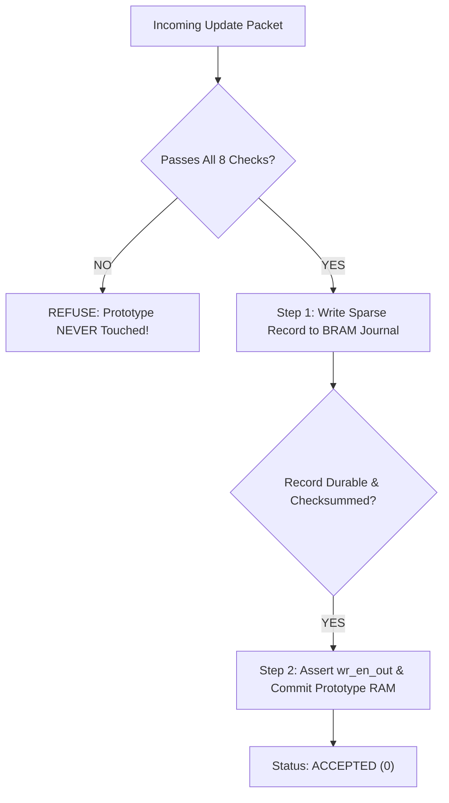
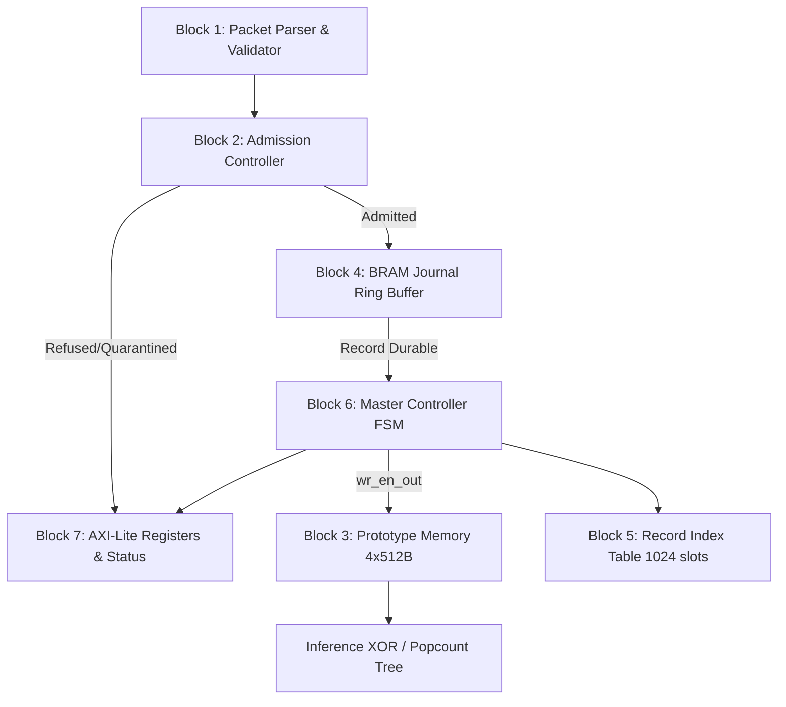

# The REVOKE-HDC Textbook: From Zero to Hero
### An Intuitive, End-to-End Guide to Reversible Updates for Compact Binary HDC Prototypes on FPGA

**Project:** REVOKE-HDC (Team P3, Live-State FPGA Studio)  
**Target Hardware:** Xilinx Kria KV260 Vision AI Starter Kit  
**Audience:** Beginners in FPGA design, Machine Learning, and Computer Architecture  

---

## Welcome to REVOKE-HDC!

If you are reading this, you might be asking yourself:
- *What is Hyperdimensional Computing (HDC)?*
- *Why are we putting it on an FPGA instead of a GPU or CPU?*
- *Why does converting numbers to binary bits cause catastrophic "memory loss"?*
- *How does REVOKE-HDC allow us to hit "Ctrl+Z" (undo) on a live hardware brain without wasting memory?*

This document is designed as a **complete, beginner-friendly textbook**. You do not need a PhD in electrical engineering or machine learning to understand it. We will start from absolute zero, build intuition with everyday analogies, walk through the math step-by-step, dissect the hardware architecture, and explain every line of results.

---

## Table of Contents
1. [Chapter 1: The Basics — What is HDC and Why FPGAs?](#chapter-1-the-basics--what-is-hdc-and-why-fpgas)
2. [Chapter 2: The Core Problem — Why Thresholding Destroys Memory](#chapter-2-the-core-problem--why-thresholding-destroys-memory)
3. [Chapter 3: The Big Idea — Write-Ahead Logging & Residues](#chapter-3-the-big-idea--write-ahead-logging--residues)
4. [Chapter 4: The Math Made Simple — Sizing and Slices](#chapter-4-the-math-made-simple--sizing-and-slices)
5. [Chapter 5: Anatomy of the Hardware — The 7 Core Blocks](#chapter-5-anatomy-of-the-hardware--the-7-core-blocks)
6. [Chapter 6: Life of an Update — From Sensor to Memory](#chapter-6-life-of-an-update--from-sensor-to-memory)
7. [Chapter 7: Life of a Restoration — The "Undo" Operation](#chapter-7-life-of-a-restoration--the-undo-operation)
8. [Chapter 8: Refusals and Error Handling (Codes 0 to 10)](#chapter-8-refusals-and-error-handling-codes-0-to-10)
9. [Chapter 9: The Four Comparison Arms (A, B, C, D)](#chapter-9-the-four-comparison-arms-a-b-c-d)
10. [Chapter 10: Experimental Proof — How We Verified 0 Mismatches](#chapter-10-experimental-proof--how-we-verified-0-mismatches)
11. [Chapter 11: Hands-On Tutorial — Run It Yourself in 60 Seconds](#chapter-11-hands-on-tutorial--run-it-yourself-in-60-seconds)
12. [Glossary: Key Terms Demystified](#glossary-key-terms-demystified)

---

## Chapter 1: The Basics — What is HDC and Why FPGAs?

### 1.1 What is an FPGA?
Imagine a regular computer chip (like an Intel CPU or Nvidia GPU). When it leaves the factory, its microscopic circuits are permanently etched in silicon. You can write software for it, but the physical wiring never changes.

An **FPGA** (Field-Programmable Gate Array) is fundamentally different: it is an ocean of millions of tiny logic gates and memory blocks whose physical interconnections can be **reconfigured by software**. It is like having a breadboard of digital chips that can transform into whatever dedicated hardware machine you desire.

On edge devices (like autonomous drones, wearable medical monitors, and satellites), FPGAs are prized because they can run customized AI models using a fraction of the power consumed by GPUs.

### 1.2 What is Hyperdimensional Computing (HDC)?
Traditional machine learning (like Deep Neural Networks) represents information using complex matrices of 32-bit floating-point decimal numbers. Multiplying large matrices burns significant energy and requires millions of clock cycles.

**Hyperdimensional Computing (HDC)** takes inspiration from the human brain. The human cortex contains billions of neurons that communicate through sprawling patterns of electrical pulses. In HDC:
- Every concept, word, pixel, or sensor reading is mapped into a massive, random pattern called a **Hypervector**.
- In our project, every hypervector has **$D = 4096$ dimensions** (4,096 bits long).
- Because 4096 is such a large dimension, any two random hypervectors are naturally **orthogonal** (they share roughly 50% identical bits and have a Hamming distance around 2048).

### 1.3 The Three Core HDC Operations
HDC manipulates hypervectors using three simple operations:
1. **Binding (Multiplication / XOR $\oplus$)**:
   - Binds two concepts together (e.g., `Sensor_ID` $\oplus$ `Sensor_Value`).
   - The result is orthogonal (completely different) from both inputs. It acts like a key-value pair!
2. **Bundling (Superposition / Addition $+$)**:
   - Adds multiple hypervectors together to represent a set or composite idea:
     $$S = V_1 + V_2 + V_3 + \dots$$
   - The bundled hypervector remains similar to each of its constituent vectors.
3. **Permutation (Cyclic Shift $\rho$)**:
   - Shifts bits to represent sequential or time-series relationships (e.g., "word A followed by word B").

### 1.4 How Classification Works (Prototypes and Hamming Distance)
Suppose we want to classify human activity into 4 classes: `0: Idle`, `1: Normal Operation`, `2: High Load`, `3: Critical State`.

1. During training, all hypervectors belonging to Class 0 are bundled into an accumulator vector called the **Class Prototype** ($P_0$).
2. During inference (runtime), a new query sample arrives from the sensors and is encoded into a query hypervector $Q$.
3. We compare $Q$ against each class prototype ($P_0, P_1, P_2, P_3$) using the **Hamming Distance**:
   $$\text{Hamming}(Q, P_c) = \text{popcount}(Q \oplus P_c)$$
   *(XOR highlights the bits that differ; popcount counts how many 1s there are).*
4. The prototype with the smallest Hamming distance is our predicted winner!

### 1.5 Why Binarize? (The 1-Bit Prototype)
If a class prototype keeps 32-bit integer counters for all 4096 dimensions, storing 4 class prototypes requires:
$$4 \times 4096 \times 4 \text{ bytes} = 65,536 \text{ bytes} = 64 \text{ KiB}$$
Furthermore, comparing a query against integer counters requires 4096 integer subtractions.

Instead, we **binarize** the prototype:
$$b_d = \text{sign\_threshold}(c_d) = \begin{cases} 1 & \text{if } c_d \ge 0 \\ 0 & \text{if } c_d < 0 \end{cases}$$

Now, each prototype is only **4096 bits = 512 bytes**!
All 4 classes fit in just **2 KiB of memory**.
And inference is reduced to a single-cycle bitwise XOR and an adder tree on the FPGA. It is blazing fast and ultra-low power.

---

## Chapter 2: The Core Problem — Why Thresholding Destroys Memory

Everything sounds great so far—until our device needs to learn **online**.

### 2.1 The Need for Online Updates
In the real world, sensors drift, environmental temperatures change, and edge devices encounter new scenarios. When a new valid sample arrives, the system performs an **online update**: it adjusts the class prototype so the model improves over time.

### 2.2 The Catastrophe of Threshold Information Loss
Let's look closely at the threshold function:
$$\text{sign\_threshold}(c) = \begin{cases} 1 & \text{if } c \ge 0 \\ 0 & \text{if } c < 0 \end{cases}$$

Notice that this function is **many-to-one** (non-injective):
- If the internal signed count was $c = +1$, the stored bit is `1`.
- If the internal signed count was $c = +100$, the stored bit is **also `1`**.

The stored bit `1` completely conceals how confident that dimension was!

Now imagine an online update arrives that subtracts $4$ from both dimensions ($u = -4$):
1. **Dimension A** (was $c = +1$):
   $$c' = +1 + (-4) = -3 \implies \text{New stored bit is } \mathbf{0} \quad (\text{FLIPPED!})$$
2. **Dimension B** (was $c = +100$):
   $$c' = +100 + (-4) = +96 \implies \text{New stored bit is } \mathbf{1} \quad (\text{UNCHANGED!})$$

Both dimensions started with stored bit `1`. Both received update $-4$. But one flipped, and the other did not!

```text
Dimension A: Count = +1  ---[sign_threshold]---> Bit = 1  ---[Update: -4]---> Count = -3  ---[sign]---> Bit = 0 (FLIPPED)
Dimension B: Count = +100 --[sign_threshold]---> Bit = 1  ---[Update: -4]---> Count = +96 ---[sign]---> Bit = 1 (STAYED 1)
```

### 2.3 Why You Cannot Simply "Subtract" or "XOR" to Undo
Suppose 10 seconds later, the system discovers that the camera was covered by a smudge or an attacker injected a bad training frame. We need to **revoke (undo)** that update.

- **Can we use XOR?**
  If we toggle the bits of the update vector, we would flip Dimension B from $1 \to 0$, even though Dimension B never flipped during the update! **Result: Massive memory corruption.**
- **Can we subtract the hypervector?**
  We only have binary bits ($0$ or $1$) in memory. We threw away the original counts $+1$ and $+100$! We don't know what to subtract from!

**Conclusion:** Without a dedicated mechanism, **an update to a compact binary prototype is permanent and irreversible.**

---

## Chapter 3: The Big Idea — Write-Ahead Logging & Residues

How do we give our hardware an exact "Ctrl+Z" (undo) button without keeping giant 64 KiB accumulator tables?

REVOKE-HDC takes an idea from mission-critical enterprise database engines (like PostgreSQL and Oracle) called **Write-Ahead Logging (WAL)**, and re-invents it for single-bit FPGA hardware.

### 3.1 The Concept of the "Residue"
Remember: an update only flips a dimension if that dimension's count was **already close to 0 (the threshold)**!
- If an update has maximum magnitude $|u|_{\max} = 8$, a count at $+50$ can *never* cross the threshold ($50 - 8 = 42 > 0$).
- A count at $-30$ can *never* cross the threshold ($-30 + 8 = -22 < 0$).
- **Only dimensions where $|c| < 8$ can ever flip!**

We define the **Residue** ($r$) as the exact distance of the dimension to the threshold before the update.
Because $|c| < 8$, this residue fits in a tiny **4-bit signed number** (range $-8$ to $+7$).

### 3.2 The Write-Ahead Discipline (Record-before-Commit)
When a candidate update packet arrives:
1. The hardware does **not** touch the prototype memory yet.
2. It writes a compact **Sparse Journal Record** containing only the dimensions that flip into an on-chip BRAM ring buffer.
3. Only when the journal confirms that the record is securely saved and checksummed does the hardware allow the prototype memory's write-enable wire (`wr_en_out`) to go HIGH.
4. **No record = No mutation.** If power cuts out or the packet is corrupt, the prototype memory is never corrupted.



### 3.3 Exact Restoration via LIFO (Reverse Commit Order)
When a revocation request arrives for an update:
1. The hardware checks that this update was the **most recent update applied to that class** (Last-In, First-Out / LIFO order).
2. It reads back the 4-bit residues saved in the journal.
3. It recomputes the exact old bit using:
   $$\text{old\_bit} = \text{sign\_threshold}(residue) = \begin{cases} 1 & \text{if } residue \ge 0 \\ 0 & \text{if } residue < 0 \end{cases}$$
4. It writes those old bits back into the prototype memory.
5. The prototype is restored **bit-for-bit to its exact prior state**, without ever keeping full 16-bit integer counters!

---

## Chapter 4: The Math Made Simple — Sizing and Slices

Let's do the arithmetic together. You will see why this architecture saves so much memory.

### 4.1 Packet and Record Sizing
- Prototype Dimension: $D = 4096$ bits ($512$ bytes).
- Max affected dimensions per update: $F \le 96$.

#### Wire Packet (Host $\to$ FPGA):
- **16-byte Header**: Contains `source_id`, `update_id`, `class_id`, `sequence`, modality margins, length, and CRC-16 checksum.
- **3 bytes per affected dimension**: 12 bits for dimension index ($0..4095$), 4 bits signed residue, 4 bits signed contribution, and 2 expected bit flags.
$$L_{\text{wire}}(F) = 16 + 3F \text{ bytes}$$
For $F = 96$: $L_{\text{wire}} = 16 + 3(96) = \mathbf{304 \text{ bytes}}$.

#### Persisted Journal Record (Stored in FPGA BRAM):
Once validated, we throw away the contribution and expected bits because the old bit is strictly recoverable from the residue!
- **16-byte Header**: Identifies the update.
- **2 bytes per affected dimension**: 12 bits dimension index + 4 bits signed residue.
$$R(F) = 16 + 2F \text{ bytes}$$
For $F = 96$: $R(96) = 16 + 2(96) = \mathbf{208 \text{ bytes}}$.
For typical $F = 40$: $R(40) = 16 + 2(40) = \mathbf{96 \text{ bytes}}$.

### 4.2 The Snapshot Comparison and Break-Even Proof
What if we just saved a full copy of the 512-byte prototype before every update? That is called a **Full Snapshot** (Arm C). A snapshot always costs exactly **512 bytes**.

When is our sparse record smaller than a full snapshot?
$$R(F) < 512$$
$$16 + 2F < 512$$
$$2F < 496$$
$$\mathbf{F < 248}$$

As long as an update flips fewer than $248$ dimensions out of $4096$, **sparse journaling wins**!

Because our maximum update size is capped at $F_{\max} = 96$:
- At $F = 40$: 96 bytes vs 512 bytes $\implies \mathbf{81.3\% \text{ memory savings!}}$
- At $F = 96$: 208 bytes vs 512 bytes $\implies \mathbf{59.4\% \text{ memory savings!}}$

| $F$ (Flips) | Wire Length ($16 + 3F$) | Journal Record ($16 + 2F$) | Snapshot Size | Memory Savings | Note |
|:---:|:---:|:---:|:---:|:---:|---|
| **0** | 16 B | 16 B | 512 B | **96.9%** | Metadata / Heartbeat packet |
| **40** | 136 B | **96 B** | 512 B | **81.3%** | **Week 1 Smallest Test milestone** |
| **52** | 172 B | 120 B | 512 B | **76.6%** | Week 5 Accepted Path |
| **60** | 196 B | 136 B | 512 B | **73.4%** | Week 5 Bad Update Path |
| **96** | 304 B | **208 B** | 512 B | **59.4%** | **Frozen Maximum Supported Record** |
| **247** | 757 B | **510 B** | 512 B | **0.4%** | Last byte where sparse wins |
| **248** | 760 B | **512 B** | 512 B | **0.0%** | **Exact Break-Even Boundary** |

---

## Chapter 5: Anatomy of the Hardware — The 7 Core Blocks

REVOKE-HDC is organized into seven modular hardware blocks, as specified in `PROJECT_PLAN.md`:



### Block 1: Packet Parser & Validator
- Receives raw bytes over the input stream.
- Verifies that packet length equals $16 + 3F$ and format version is `0x00`.
- Evaluates the **CRC-16/CCITT-FALSE** polynomial `0x1021` to detect transmission noise.
- Checks a 4096-bit internal scoreboard to ensure no dimension is repeated within the same packet.

### Block 2: Admission Controller (The Trust Gate)
- Implements multi-modal sensory fusion:
  - Modality A (e.g. Vision camera) provides hypothesis label $h_A$ and confidence margin $m_A$.
  - Modality B (e.g. IMU gyro/accelerometer) provides hypothesis label $h_B$ and confidence margin $m_B$.
- **Admission Rule**: Both sensors must agree on the target class ($h_A = h_B = \text{class\_id}$), and both confidence margins must be above threshold ($m_A \ge 128, m_B \ge 128$).
- Checks that the journal has enough room ($J_{\text{req}} \le J_{\text{free}}$).
- Checks that the sender's expected old bit matches what is currently stored in memory.

### Block 3: Prototype Memory
- 4 class prototypes. Each class has 64 words of 64 bits ($64 \times 64 = 4096$ bits = 512 bytes).
- Implements **64-bit word write-mask combining**:
  - When committing an update, multiple dimensions landing in the same 64-bit word are combined into one word write.
  - Updating Word 0 takes 1 cycle, regardless of whether 1 dimension or 10 dimensions in Word 0 flipped!

### Block 4: BRAM Journal Memory (Ring Buffer)
- 256 KiB of on-chip Block RAM (BRAM).
- Stores the append-only journal records.
- Implements the **Pad-to-End Wrap Policy**:
  - If a 208-byte record arrives and only 50 bytes remain before the end of the ring buffer, the allocator inserts a small pad marker and writes the record cleanly at offset 0.
  - Records **never split across the ring boundary**, keeping read/write logic simple and fast.

### Block 5: Record Index Table
- A fixed table of 1024 slots.
- Each slot tracks an update's `update_id`, `class_id`, `state`, ring offset, byte length, and a pointer to the previous update in that class (`prev_slot_id`).
- Implements **strict state transitions**:
  $$\text{FREE} \longrightarrow \text{ACTIVE} \longrightarrow \text{RESTORING} \longrightarrow \text{RETIRED}$$

### Block 6: Master Commit / Restore Controller
- The brain of the chip. It manages the master finite state machine (FSM).
- **Critical Safety Wire**: It is the *only* module permitted to drive `wr_en_out` (the write-enable wire of the prototype memory).
- It holds `wr_en_out` LOW during parsing, checking, and journal writing, asserting it only during the commit cycle.

### Block 7: AXI-Lite Status & Observability Block
- Memory-mapped to the ARM CPU on the KV260 at physical address `0xA000_0000`.
- Lets you inspect the chip from a Linux bash terminal using simple memory reads!
- Exposes `LAST_OUTCOME_CODE`, `JOURNAL_FREE_BYTES`, `UPDATE_COUNTER`, `RESTORE_COUNTER`, prototype CRC-32 checksums, and a 512-entry cycle-stamped event trace buffer.

---

## Chapter 6: Life of an Update — From Sensor to Memory

To see how everything fits together, let's follow a single packet through the system from start to finish.

```text
Host Stream ===> [Byte 0..15: Header] [Byte 16..21: Entry 1 & 2] ===> FPGA
```

### Stage 1: Framing and CRC Check
- The packet arrives with $F = 2$ entries (length = $16 + 3(2) = 22$ bytes).
- The parser verifies that the CRC-16 checksum in bytes 14-15 matches the payload.
- It checks that Entry 1 (dim 100) and Entry 2 (dim 200) are distinct dimensions (no duplicates).

### Stage 2: Arithmetic Sanity Check
- Entry 1: residue $r = -3$, contribution $u = +5$.
  - Old bit: $\text{sign\_threshold}(-3) = 0$.
  - New bit: $\text{sign\_threshold}(-3 + 5) = \text{sign\_threshold}(+2) = 1$.
  - Sender claimed: old bit = 0, new bit = 1. **Match!**
- Entry 2: residue $r = +2$, contribution $u = -5$.
  - Old bit: $\text{sign\_threshold}(+2) = 1$.
  - New bit: $\text{sign\_threshold}(+2 - 5) = \text{sign\_threshold}(-3) = 0$.
  - Sender claimed: old bit = 1, new bit = 0. **Match!**

### Stage 3: The Trust Gate & Stale Check
- Modality A margin $m_A = 180 \ge 128$.
- Modality B margin $m_B = 165 \ge 128$.
- Both predict Class 0. **Trust gate passes!**
- The controller reads prototype memory:
  - Bit at dim 100 is currently `0`. (Matches expected old bit).
  - Bit at dim 200 is currently `1`. (Matches expected old bit).
  - **Memory is not stale!**

### Stage 4: Write-Ahead Logging to BRAM
- Required journal space: $16 + 2(2) = 20 \text{ bytes}$.
- Controller writes the 20-byte record into the BRAM ring buffer.
- Ring buffer signals `record_durable = 1`.
- Record Index Table allocates Slot 1 for Class 0, sets state = `ACTIVE`.

### Stage 5: Masked Prototype Commit
- Controller generates write masks:
  - Dim 100 is in Word 1 (`100 >> 6 = 1`), bit position 36 (`100 & 63 = 36`).
  - Dim 200 is in Word 3 (`200 >> 6 = 3`), bit position 8 (`200 & 63 = 8`).
- Word 1 updated with bit 36 set to `1`.
- Word 3 updated with bit 8 set to `0`.
- Write-enable deasserts.
- `UPDATE_COUNTER` increments to 1.
- `LAST_OUTCOME_CODE` set to `0` (`ACCEPTED`).

---

## Chapter 7: Life of a Restoration — The "Undo" Operation

Now let's see how REVOKE-HDC performs an exact undo.

### Step 1: The Request
Host issues a restoration request:
$$\text{Restore(Class = 0, Update ID = 1001)}$$

### Step 2: The Reverse Commit Order Check (LIFO)
- The controller checks Slot 1.
- Is Slot 1 the current head of Class 0? **Yes!**
- Is Slot 1 in `ACTIVE` state? **Yes!**
*(If a newer update had been applied to Class 0, this check would fail with `refused_ordering` (7) to prevent overwriting newer changes).*

### Step 3: Prototype Bit-State Check
- Slot 1 expected dim 100 to be `1` and dim 200 to be `0`.
- Controller reads prototype memory. Both bits match!
- State transitions: `ACTIVE -> RESTORING`.

### Step 4: Bit Reconstruction from Residue
- Controller reads the 20-byte record from BRAM.
- Entry 1: stored residue is $-3$.
  $$\text{restored\_bit} = \text{sign\_threshold}(-3) = \mathbf{0}$$
- Entry 2: stored residue is $+2$.
  $$\text{restored\_bit} = \text{sign\_threshold}(+2) = \mathbf{1}$$

### Step 5: Application & Retirement
- Controller applies masked write to Word 1 (bit 36 restored to `0`) and Word 3 (bit 8 restored to `1`).
- Slot 1 state transitions: `RESTORING -> RETIRED`.
- Class 0 head pointer moves to the previous update (`prev_slot_id`).
- `RESTORE_COUNTER` increments to 1.
- `LAST_OUTCOME_CODE` set to `9` (`RESTORED`).
- **Memory is restored bit-for-bit to its exact pre-update state!**

### Step 6: Protection Against Repeat Restorations
What if software accidentally sends the same restore command again?
- Controller looks up Slot 1.
- Slot 1 is already in `RETIRED` state!
- Controller returns `10` (`ALREADY_RETIRED`), leaves `wr_en_out` LOW, and flips zero bits.

---

## Chapter 8: Refusals and Error Handling (Codes 0 to 10)

A dependable hardware system must handle bad inputs gracefully. REVOKE-HDC defines **11 explicit outcome codes**:

| Code | Outcome Name | Memory Changed? | Why Did This Happen? |
|:---:|---|:---:|---|
| **0** | `ACCEPTED` | **YES** | Perfect packet! Stored in BRAM journal, prototype committed. |
| **1** | `QUARANTINED` | **NO** | Sensor disagreement ($h_A \ne h_B$) or low confidence ($m_A < 128$). |
| **2** | `REFUSED_CAPACITY` | **NO** | BRAM ring buffer is full, or all 1024 index slots are used. |
| **3** | `REFUSED_CHECKSUM` | **NO** | Electrical noise corrupted packet bytes; CRC-16 failed. |
| **4** | `REFUSED_RESIDUE` | **NO** | Contribution outside $[-8, +7]$ (or conceptual $+8$ which overflows 4 bits). |
| **5** | `REFUSED_STALE` | **NO** | Packet formed against old state; current stored bit doesn't match old bit. |
| **6** | `REFUSED_DUPLICATE` | **NO** | Same dimension index appeared twice in the same packet. |
| **7** | `REFUSED_ORDERING` | **NO** | Update sequence skipped, or restore request was not the class head. |
| **8** | `REFUSED_BIT_STATE` | **NO** | Header format invalid, or prototype bit was corrupted before restore. |
| **9** | `RESTORED` | **YES (Reverted)** | Exact reversal complete; prior bits restored, slot retired. |
| **10** | `ALREADY_RETIRED` | **NO** | Duplicate restore request on an already-reversed record. |

> **Invariant 7 (The Immutability Guarantee):**  
> For any code from 1 to 8 and code 10, **not a single bit of prototype RAM is altered**, and **not a single byte of journal memory is consumed**.

---

## Chapter 9: The Four Comparison Arms (A, B, C, D)

To rigorously evaluate REVOKE-HDC in academic benchmarks, we measure four distinct arms under identical update streams:

```text
[Stream of Encoded Sensor Samples] 
       │
       ├──> Arm A: Full Signed Accumulators (Golden Reference, 8192 Bytes/Class)
       ├──> Arm B: Packed Binary Only (Unprotected Baseline, 0 Bytes/Update)
       ├──> Arm C: Full Prototype Snapshots (Brute-Force Baseline, 512 Bytes/Update)
       └──> Arm D: REVOKE-HDC Sparse Journal (Proposed Solution, 16 + 2F Bytes/Update)
```

1. **Arm A (Full Signed Counts)**:
   - Stores complete 16-bit integer counters for all 4096 dimensions ($8192 \text{ bytes per class}$).
   - Updates add numbers directly; restores subtract numbers directly.
   - *Pros:* Exact by definition.
   - *Cons:* Too large and expensive for fast on-chip inference.
2. **Arm B (Packed Binary Only — No Restoration)**:
   - Stores only 512 bytes per class.
   - Applies updates directly with XOR. Cannot restore.
   - *Pros:* Zero extra storage.
   - *Cons:* A single bad training frame permanently damages classification accuracy.
3. **Arm C (Full Prototype Snapshots)**:
   - Stores a complete 512-byte backup image of the prototype before every update.
   - *Pros:* Exact restoration via full memory copy-back.
   - *Cons:* Fixed 512 bytes per update. Rapidly exhausts on-chip BRAM.
4. **Arm D (REVOKE-HDC — Proposed)**:
   - Word-packed binary prototype + write-ahead sparse residue journal.
   - Costs only $16 + 2F$ bytes per update (average $97.2 \text{ bytes}$).
   - *Pros:* **Bit-identical exact restoration** while saving **59.4% to 81.3% memory** compared to Arm C!

---

## Chapter 10: Experimental Proof — How We Verified 0 Mismatches

We built a complete, bit-true software reference simulator in Python (`sim/`) and executed an exhaustive verification campaign:

### 1. The Hand-Worked Smallest Test (`tests/test_smallest_w2.py`)
- Tested the exact 2-entry hand-worked packet from Chapter 6.
- Updated dim 100 ($0 \to 1$) and dim 200 ($1 \to 0$).
- Revoked the update: dim 100 restored to $0$, dim 200 restored to $1$.
- **Result:** Exact word-for-word match with pre-update state.

### 2. The Negative Test Suite (`tests/test_negative_cases.py`)
- Injected all 10 refusal and quarantine conditions.
- Confirmed that every condition returned its exact designated outcome code.
- Verified that across all 10 failure cases, **zero prototype bits were flipped** and **journal free space was untouched**.

### 3. The 1,000-Update Continuous Regression (`tests/test_exact_restoration.py`)
- Replayed 1,000 sequential updates across all 4 classes with realistic flip counts ($F \in [2, 91]$).
- Each update was committed, and subsequently restored in reverse commit order.
- Word-for-word comparison of all 64 words $\times$ 4 classes after every restoration.
- **Results:**
  - **Total Admitted Updates:** 1,000
  - **Total Restorations:** 1,000
  - **Total Bit Mismatches:** **0 (Target: 0)** across all 4,096,000 evaluated bit positions!
  - **Golden Match:** `y`
  - **Measured Mean $F$:** $40.62$ dimensions
  - **Measured p95 $F$:** $65$ dimensions
  - **Measured Max $F$:** $91$ dimensions
  - **Average Record Size:** $97.23 \text{ bytes}$ (**81.0% savings** vs 512B snapshot)
  - **Break-Even Frequency ($F < 248$):** **100.0%** of all updates strictly beat snapshot!

---

## Chapter 11: Hands-On Tutorial — Run It Yourself in 60 Seconds

You can verify the entire project on your own machine. Everything runs using standard Python 3 and bash (zero external pip packages required).

### Step 1: Clone the Repository
```bash
git clone https://github.com/satvikviriyala/REVOKE-HDC-Reversible-Updates.git
cd REVOKE-HDC-Reversible-Updates
```

### Step 2: Run the Master Pipeline
```bash
bash P3_REVOKE_HDC/scripts/run_all.sh
```

### Step 3: Inspect the Output
In less than 3 seconds, you will see:
- `[STAGE 1]` Week 0 Hamming distance calculation and threshold loss proof.
- `[STAGE 2]` Week 1 validation of all 42 hand vectors.
- `[STAGE 3]` Week 2 smallest test and all 10 negative test cases passing.
- `[STAGE 4]` Week 2 1,000-update regression passing with **0 mismatches**.
- `[STAGE 6]` Automatic generation of vector plots in `P3_REVOKE_HDC/results/figures/`.

---

## Glossary: Key Terms Demystified

- **AXI-Lite**: A standard, lightweight on-chip bus protocol used by ARM processors to read and write control registers on an FPGA.
- **BRAM (Block RAM)**: Fast, dedicated on-chip memory blocks embedded directly in the FPGA fabric.
- **Bundling**: Adding multiple hypervectors together to represent a set or composite pattern.
- **Hamming Distance**: The number of bit positions where two binary vectors differ.
- **Hypervector**: A very wide vector (e.g. 4096 bits) with holographic, noise-tolerant properties.
- **LIFO (Last-In, First-Out)**: Reverse commit order; the most recently committed update must be the first one restored.
- **Non-Injective**: A mathematical mapping where multiple distinct inputs produce the exact same output (e.g., thresholding).
- **Popcount**: "Population count" — counting the number of set bits (`1`s) in a binary word.
- **Prototype**: The representative hypervector stored for a class (e.g. the model's memory of what "Normal Operation" looks like).
- **Residue**: The signed distance between an accumulator count and the threshold 0 immediately prior to an update.
- **WAL (Write-Ahead Logging)**: A discipline where a durable log record must be safely persisted before any actual state changes occur.
- **XOR ($\oplus$)**: Exclusive-OR; in HDC, used for binding two hypervectors together or finding bit differences.

---

*Written for the Live-State FPGA Studio (Team P3).*  
*Repository: [satvikviriyala/REVOKE-HDC-Reversible-Updates](https://github.com/satvikviriyala/REVOKE-HDC-Reversible-Updates)*
