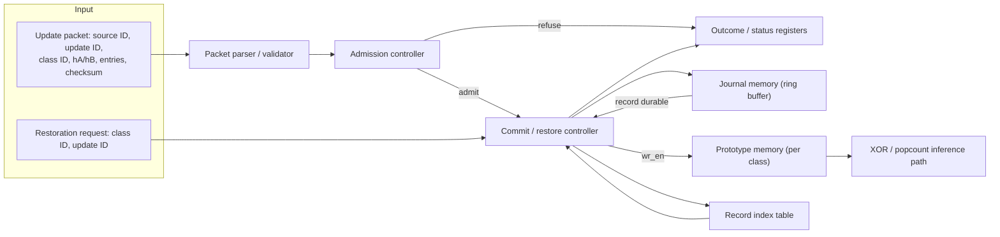

# P3 REVOKE-HDC: Project Plan

Companion to `README.md` and `EVALUATION.md`. This plan freezes the parts of the design the eight-week schedule needs fixed, adds the interface and register-level detail the README leaves open, and turns every checkpoint into something a reviewer can measure against a number. It does not repeat material `README.md` already states in full; where a number below is only illustrative, the README section that motivates it is named in brackets.

## 1. Project in one paragraph

**Plain language.** A hyperdimensional classifier keeps one packed prototype per class, and each prototype is normally updated online as new samples arrive. The trouble is that packing a signed count down to a single bit throws away how close that count was to flipping, so once a bad update has changed a bit, ordinary subtraction cannot always put it back correctly. This project builds a small hardware log that remembers, only for the handful of dimensions that were close enough to the flip point to actually change, enough information to put the prototype back exactly as it was — without keeping a full second copy of the whole prototype.

**Technical.** The design keeps a word-packed binary prototype per class (`D = 4096` dimensions, 64-bit words) queried by XOR/popcount, and a fixed-capacity journal in on-chip BRAM that stores, per accepted update, the class, source and update identifiers, and a signed pre-threshold residue for each affected dimension. A controller admits a candidate update only when two independent hypothesis checks and a margin rule agree, the packet is structurally valid, and the journal has room; it writes the record to the journal and only then allows the packed-prototype write-enable to assert (`README.md`, "Suggested architecture", lines 86-103; "Update admission", lines 105-115). Restoration walks a class's records in reverse commit order, recomputes each affected dimension's prior bit from its stored residue, and checks the currently stored bit against the record's expected post-update bit before writing anything back (`README.md`, "Exactness and ordering rules", lines 157-168). Every request — accepted, quarantined, or refused for a named reason — produces exactly one observable outcome and never leaves the prototype in an undefined state (`README.md`, "System invariants", lines 170-180).

## 2. What is different about this design

| Existing approach | What it does | What it does not do | What this design adds |
|---|---|---|---|
| OnlineHD online retraining (Hernandez-Cano et al., `WEEK_0.md` item 2) | Updates a class prototype after every misclassified sample using a single-pass additive rule | Keeps no record of the pre-threshold state, so a bad training sample cannot be undone once the bit has flipped | A bounded per-dimension residue record captured at update time, so a specific accepted update can be undone later without touching unrelated dimensions |
| QuantHD quantisation (Imani et al., `WEEK_0.md` item 3) | Compresses a signed accumulator down to a compact binary or ternary prototype for cheap inference | Documents that the compression is lossy but does not recover the discarded sign-count information afterwards | A residue field sized exactly to the supported update alphabet (`README.md`, "Residue width is not a free choice", lines 142-155), so the discarded information is captured only where it can actually change a bit |
| Write-ahead logging (WAL / ARIES-style database recovery) | Writes a durable log entry before mutating state, and replays or undoes changes from that log in commit order | Operates on generic byte-level before/after page images and checkpoints, not on a single-bit threshold decision, and is not built for a synchronous, cycle-bounded hardware datapath | The same durable-before-mutate discipline applied at the grain of one dimension's signed residue, enforced by physically withholding the prototype memory's write-enable until the journal signals a durable, checksummed record |
| Full-state snapshot / copy-on-write checkpoints | Keeps a complete second copy of the prototype before each accepted update, so restoring is a full copy-back | Costs a fixed 512 bytes per class per accepted update regardless of how many bits actually changed (`README.md` Arm C, "Required comparison arms", lines 195-204) | A sparse record that costs 2F + 16 bytes for F affected dimensions, smaller than a snapshot whenever `F < 248` (`README.md`, "Sparse record sizing", lines 117-138) |
| Double-buffered weight/state banks | Swaps between two complete memory copies to avoid read/write hazards while one copy is being rewritten | Only ever supports "current versus one previous" state, and still needs two full-size copies | Many ordered undo steps per class from one packed copy plus a small append-only log, at the cost of walking the log in reverse instead of a single bank swap |
| Drop-on-full FIFOs / best-effort admission queues | Silently drops or overwrites the oldest entry when a bounded buffer fills up | Gives no explicit accounting of what was dropped, and does not distinguish "buffer full" from "request malformed" | Journal-full is one of several explicit, logged refusal outcomes (capacity, checksum, residue, stale, duplicate, ordering, bit-state); no request is ever silently dropped |

## 3. Frozen architecture

### 3.1 Module list

| Module | Function | Key registers / RAM / counters | Key I/O signals (width) |
|---|---|---|---|
| Packet parser / validator | Frames one incoming update packet, recomputes `old_bit`/`new_bit` per entry from residue and contribution, checks length and checksum, rejects duplicate dimension indices within the packet | Entry counter; running checksum accumulator; 96-bit duplicate-index scoreboard (one flag per possible entry slot) | `pkt_data[7:0]`, `pkt_valid`, `pkt_last` (in); `entry_dim[11:0]`, `entry_residue[3:0]`, `entry_ok` (out); `parse_fail_code[2:0]` (out) |
| Admission controller | Applies the two-modality agreement and margin rule and the journal-capacity rule, and folds in the parser's pass/fail signal, to produce one `admit` decision | `theta_A[7:0]`, `theta_B[7:0]` margin-threshold registers; `j_req[15:0]` latched required bytes | `hA[1:0]`, `hB[1:0]`, `mA[7:0]`, `mB[7:0]` (in); `j_free[19:0]` (in, from journal); `admit` (out) |
| Prototype memory | One packed BRAM per class, 64 words of 64 bits (`D = 4096`); XOR/popcount read path for inference; masked read-modify-write for commit and restore | 256 words total (64 x 4 classes); `wr_mask[63:0]` combines every entry that lands in the same word in one cycle | `rd_addr[7:0]`, `rd_data[63:0]` (to popcount tree); `wr_addr[7:0]`, `wr_data[63:0]`, `wr_mask[63:0]`, `wr_en` (in, driven only by the commit/restore controller) |
| Journal memory | Byte-addressable append-only ring buffer in BRAM holding 16-byte record headers plus 2 bytes per affected dimension (index + residue only; see Section 4) | `head_ptr[19:0]`, `tail_ptr[19:0]`, `free_bytes[19:0]` | `wr_addr/wr_data[7:0]` (append path); `rd_addr/rd_data[7:0]` (restore read path) |
| Record index table | Fixed-depth register file, one row per simultaneously live record slot; carries the state field and the reverse-order chain pointer per class | Per slot: `ring_offset[19:0]`, `length[11:0]`, `class_id[1:0]`, `state[1:0]`, `prev_slot`, `update_id[15:0]` | `alloc_slot` (in) / `slot_id` (out); `state_wr_en`, `state_in[1:0]` (in, from controller) |
| Commit / restore controller | The single state machine that sequences admission through prototype commit for updates, and lookup through prototype restore for restoration requests; the only module permitted to drive the prototype write-enable | `state[3:0]`, active `class_id`, active `slot_id`, dimension cursor `[6:0]` | `admit`, `record_durable` (in); `restore_req` (in); `wr_en_out` (out, to prototype memory); `outcome_code[3:0]` (out) |
| Outcome / status register block | Exposes the register map in Section 4 to the host over AXI-Lite for logging and the demonstration script | Counters and latched checksums listed in Section 4 | `S_AXI` (AXI-Lite slave, in/out) |

### 3.2 System block diagram

### 3.3 Controller states and transition conditions

| From | To | Condition |
|---|---|---|
| `IDLE` | `PARSE` | `pkt_valid` asserted |
| `PARSE` | `ADMIT_CHECK` | packet fully framed, length and checksum pass, no duplicate dimension index |
| `PARSE` | `REFUSE` | checksum or length fails (`refused_checksum`), or a dimension index repeats within the packet (`refused_duplicate`) |
| `ADMIT_CHECK` | `JOURNAL_WRITE` | `hA = hB`, `mA >= theta_A`, `mB >= theta_B`, `j_req <= j_free`, and every entry's recomputed `old_bit` matches the currently stored prototype bit |
| `ADMIT_CHECK` | `REFUSE` | agreement/margin fails or `j_req > j_free` (`refused_capacity`); a contribution exceeds the declared alphabet (`refused_residue`); or a recomputed `old_bit` mismatches the stored bit (`refused_stale`) |
| `JOURNAL_WRITE` | `COMMIT` | record fully written and checksummed, index-table slot marked `active`; `wr_en_out` is held low for the whole of this state |
| `COMMIT` | `IDLE` | every entry's `new_bit` written into the prototype word; outcome posted as `accepted` |
| `IDLE` | `RESTORE_LOOKUP` | `restore_req` asserted |
| `RESTORE_LOOKUP` | `RESTORE_ORDER_CHECK` | a record matching the requested class ID and update ID is found and its state is not `retired` |
| `RESTORE_LOOKUP` | `REFUSE` | no matching record (`refused_ordering`), or the matching record is already `retired` (outcome `already_retired`, no bit change) |
| `RESTORE_ORDER_CHECK` | `RESTORE_BITCHECK` | the requested record is the current head of its class's chain (the most recently committed, non-retired record for that class) |
| `RESTORE_ORDER_CHECK` | `REFUSE` | a newer record exists for the same class (`refused_ordering`) |
| `RESTORE_BITCHECK` | `RESTORE_APPLY` | for every entry, the currently stored prototype bit equals the record's expected post-update bit; slot state moves `active -> restoring` |
| `RESTORE_BITCHECK` | `REFUSE` | any entry's stored bit differs from the expected post-update bit (`refused_bit_state`) |
| `RESTORE_APPLY` | `RETIRE` | every listed dimension has had its prior bit (recomputed as `sign_threshold(residue)`) written back exactly once |
| `RETIRE` | `IDLE` | slot state moves `restoring -> retired`; the class head pointer moves to `prev_slot`; outcome posted as `restored` |
| `REFUSE` | `IDLE` | outcome code posted; no prototype bit and no journal record changed |

## 4. Interface and record contract

### 4.1 Update packet (wire format, host to controller)

Header, fixed at 16 bytes:

| Field | Width | Notes |
|---|---|---|
| `source_id` | 8 bits | identifies the sending modality/harness |
| `update_id` | 16 bits | monotonic, identifies this update for a later restoration request |
| `class_id` | 8 bits (2 used, 6 reserved) | selects one of 4 prototypes |
| `sequence` | 16 bits | per-class monotonic count, cross-checked against the index-table chain at admission |
| `hA`, `mA` | 8 bits, 8 bits | modality-A hypothesis label and margin |
| `hB`, `mB` | 8 bits, 8 bits | modality-B hypothesis label and margin |
| `entry_count` (`F`) | 8 bits (0-96 used) | number of affected-dimension entries that follow |
| `length` | 16 bits | total packet length in bytes, header plus payload plus checksum |
| `reserved/format` | 8 bits | format version, zero in the frozen build |
| `checksum` | 16 bits | CRC-16 over header and payload, closes the packet |

Per-entry payload, 3 bytes (24 bits) each, repeated `F` times (`F <= 96`):

| Field | Width | Notes |
|---|---|---|
| `dimension_index` | 12 bits | `0..4095` |
| `pre_update_residue` | 4 bits, signed | range `-8..+7` |
| `update_contribution` | 4 bits, signed | magnitude asserted `<= 8` at parse time; a packet with any larger contribution is refused with `refused_residue` |
| `expected_old_bit` | 1 bit | sender's claimed `sign_threshold(pre_update_residue)`, cross-checked by the parser |
| `expected_new_bit` | 1 bit | sender's claimed `sign_threshold(pre_update_residue + update_contribution)`, cross-checked by the parser |
| reserved | 2 bits | zero |

Maximum wire packet size: `16 + 96 * 3 = 304` bytes.

### 4.2 Persisted journal record (BRAM ring, host fields never re-sent)

The parser cross-checks `expected_old_bit` and `update_contribution` once against its own recomputation and then discards them: only the dimension index and the residue are worth keeping, because the old bit is always recoverable later as `sign_threshold(residue)`. The persisted record therefore reuses the 16-byte wire header unchanged and stores a 2-byte entry (index plus residue) per affected dimension, exactly reproducing the sizing worked in `README.md` ("Sparse record sizing", lines 117-131): `16 + F * 2` bytes, `208` bytes at `F = 96`. This is why the design is smaller than the wire packet that produced it, and it is the concrete reason the record stays below the `512`-byte snapshot size for every `F < 248`.

### 4.3 Outcome record (one per update or restoration request, retained for audit)

| Field | Width |
|---|---|
| `request_type` | 1 bit (0 = update, 1 = restore) |
| `class_id` | 2 bits |
| `source_id` | 8 bits (update requests only, else zero) |
| `update_id` | 16 bits |
| `outcome_code` | 4 bits (Section 4.5) |
| `slot_id` | ceil(log2(N)) bits, N = index-table depth |
| `cycle_timestamp` | 32 bits |
| `affected_count` | 8 bits |

Packed and padded to 12 bytes for word alignment.

### 4.4 Trace record (ring buffer of recent controller events)

| Field | Width |
|---|---|
| `cycle_timestamp` | 32 bits |
| `event_type` | 4 bits: admit / refuse / journal_write / commit / restore_lookup / restore_apply / retire |
| `class_id` | 2 bits |
| `update_id` | 16 bits |
| `outcome_code` | 4 bits |
| `dimension_cursor` | 7 bits, which entry within a multi-entry operation the event refers to |

Packed to 8 bytes; the trace buffer depth is a Week 3 sizing decision (Section 10).

### 4.5 Outcome code enumeration (4 bits)

| Code | Meaning | Prototype changed? |
|---:|---|---|
| 0 | accepted | yes |
| 1 | quarantined | no |
| 2 | refused - capacity | no |
| 3 | refused - checksum | no |
| 4 | refused - residue (includes alphabet exceeded) | no |
| 5 | refused - stale | no |
| 6 | refused - duplicate | no |
| 7 | refused - ordering | no |
| 8 | refused - bit-state | no |
| 9 | restored | yes (reverted) |
| 10 | already-retired (repeat restoration request) | no |

### 4.6 AXI-Lite control/status register map

| Offset | Name | Access | Meaning |
|---|---|---|---|
| `0x00` | `CTRL` | RW | `enable`, `soft_reset`, `class_select` |
| `0x04` | `STATUS` | RO | `busy`, `last_outcome_valid` |
| `0x08` | `LAST_OUTCOME_CODE` | RO | 4-bit code, Section 4.5 |
| `0x0C` | `LAST_UPDATE_ID` | RO | identifier of the most recently processed request |
| `0x10` | `JOURNAL_FREE_BYTES` | RO | current `free_bytes` counter |
| `0x14` | `JOURNAL_HEAD_OFFSET` | RO | ring head pointer |
| `0x18` | `JOURNAL_TAIL_OFFSET` | RO | ring tail pointer |
| `0x1C` | `CLASS_HEAD_SLOT` | RO | head record slot for `CTRL.class_select` |
| `0x20` | `UPDATE_COUNTER` | RO | accepted-update count |
| `0x24` | `RESTORE_COUNTER` | RO | successful-restoration count |
| `0x28` | `REFUSED_COUNTER` | RO | refused/quarantined count |
| `0x2C` | `PROTOTYPE_CHECKSUM` | RO | CRC-32 of `CTRL.class_select`'s packed prototype, latched on read |
| `0x30` | `TRACE_POP` | RO | pops one 8-byte trace record (two 32-bit reads) |
| `0x34` | `TRACE_COUNT` | RO | trace records currently buffered |

### 4.7 Observability on the KV260

Every field above is reachable without a logic analyser: the register map is memory-mapped over AXI-Lite from the Zynq UltraScale+ processing system, so a host-side console can print `LAST_OUTCOME_CODE`, the journal counters and `PROTOTYPE_CHECKSUM` after every injected packet during the Week 5 demonstration (Section 8). `TRACE_POP` gives a cycle-stamped record of the admit/refuse/commit/restore sequence for the annotated trace required in Week 8. During bring-up, the same internal signals (`wr_en_out`, `state`, `record_durable`) are additionally watched with a Vivado ILA; the ILA is a debug aid only and is not part of the frozen interface.

## 5. Correctness invariants as testable assertions

| # | Invariant | Simulation assertion / checker |
|---:|---|---|
| 1 | The prototype write-enable never asserts before a request reaches `COMMIT` or `RESTORE_APPLY`. | `assert property (@(posedge clk) wr_en_out |-> state==COMMIT \|\| state==RESTORE_APPLY);` |
| 2 | A journal record becomes valid (index-table slot marked `active`) strictly before the first prototype write of the same request. | Scoreboard compares the cycle timestamp of the index-table write against the first `wr_en_out` pulse for the same `update_id`; fails if the order inverts. |
| 3 | Restoration proceeds only against the current head-of-chain record for that class (reverse commit order). | `assert property (state==RESTORE_ORDER_CHECK && next_state==RESTORE_BITCHECK \|-> slot_id == class_head_slot[class_id]);` |
| 4 | Each record's state visits `active -> restoring -> retired` exactly once and never revisits `active` or skips `restoring`. | Per-slot state-transition monitor; any transition outside the three legal edges raises an illegal-transition error. |
| 5 | A repeated restoration request against a `retired` slot returns `already_retired` and flips no bit. | `assert property (slot_state==RETIRED && restore_req \|-> outcome_code==10 && !wr_en_out);` |
| 6 | Restoration writes back only when every listed dimension's current bit equals the record's expected post-update bit. | Per-entry compare in `RESTORE_BITCHECK` reduced to one `ok` signal; `assert property (state==RESTORE_APPLY \|-> $past(ok));` |
| 7 | A refused or quarantined request changes neither the prototype word nor the journal `free_bytes` counter. | Testbench snapshot/compare of the addressed prototype word and `free_bytes` immediately before and after every negative-test vector (Week 2 negative-test suite). |
| 8 | No byte range belonging to a live (`active` or `restoring`) record is overwritten by a later `JOURNAL_WRITE`. | `assert property (wr_addr inside {[ring_offset:ring_offset+length-1]} \|-> slot_state[matching_slot]==FREE);` allocator returns `refused_capacity` rather than wrapping over a live slot. |
| 9 | An accepted update followed immediately by its own restoration reproduces the pre-update prototype word for word. | Week 2 zero-mismatch regression: word-compare (or CRC-32 compare) of all 64 words across all 4 classes against a saved pre-update reference. |
| 10 | No dimension is written twice within a single commit or a single restoration. | Parser-side duplicate check (`refused_duplicate`) at admission; a per-request "seen" bitmap of width `D` gates the restore-apply loop. |
| 11 | A restoration request locates a record only when class ID, update ID and stored source ID all match; any mismatch is `refused_ordering`, never a silent no-op. | Dedicated negative test asserts `outcome_code==7` and `slot_id` unresolved when any one of the three identifiers is altered. |
| 12 | Every request produces exactly one outcome-log entry and increments exactly one counter in the Section 4.6 register map. | Monitor counts outcome-log writes 1:1 against packets and restoration requests issued over a directed or randomised sequence. |

These restate `README.md` "Exactness and ordering rules" (lines 157-168) and "System invariants" (lines 170-180) as checkable properties; Weeks 2 and 4 are where the corresponding testbenches are built (Section 7).

## 6. Comparison arms A-D: metrics, boundary, and success/negative results

| Arm | Stored model/update state | Restoration behaviour | Success criterion | Negative-result criterion |
|---|---|---|---|---|
| A | Full signed per-dimension counts | Updates and reversals use the complete numeric state directly | Exact by construction; serves as the accuracy/exactness reference, not a memory-competitive design | A mismatch here means the workload generator or encoder is at fault, not the journal design |
| B | Packed binary prototype only | No restoration support; a bad update is permanent | Establishes the accuracy floor with no recovery mechanism at all | Not applicable; Arm B is expected not to restore, so its result is the baseline harm being solved |
| C | Full packed-prototype snapshot per accepted update | Exact restoration by copying the saved snapshot back | Bit-exact restoration; the memory-cost baseline at a fixed `512` bytes/class/update (`README.md`, line 132) | A mismatch here indicates a harness fault, since Arm C's mechanism is a plain copy-back |
| D | Packed prototype plus fixed-capacity sparse residue journal (Sections 3-4) | Reverse-commit-order restoration from per-dimension residues | Bit-exact restoration at strictly less memory than Arm C for every observed `F < 248` (`README.md`, lines 132-138) | Any bit mismatch after restoration, any accepted-update memory cost exceeding Arm C's for the same `F`, or any refusal that changes a prototype bit |

### 6.1 Metrics collected identically across all four arms

| Metric | How it is measured |
|---|---|
| Exact restoration | Word-for-word compare of the full `D`-bit prototype after restoration against a saved pre-update reference (Arms A, C, D) |
| Bytes per update | A: fixed at `D * counter_width` (all dimensions, always); B: `0`; C: fixed `512` bytes; D: `16 + 2F` bytes, variable with the packet's affected-dimension count |
| Journal/record capacity | Total BRAM bytes committed to the recovery mechanism, plus measured occupancy over time for Arms C and D |
| Update/restoration cycles | Clock cycles from the request being asserted (`pkt_valid` or `restore_req`) to `outcome_code` being posted |
| Refused updates | Count and outcome-code breakdown (Section 4.5) per 1,000 requests |
| Flip density | Distribution of `F` (mean, p95, maximum) over the frozen workload |
| Classification accuracy | Measured three times per injected bad update: immediately before it commits, immediately after it commits, and after its restoration completes |

### 6.2 Measurement boundary

All four arms replay the same encoded sample stream, the same update order, the same source labels and the same restoration requests under the same random seed, per `README.md` "Required comparison arms" (line 204) and the root `README.md` rule "Compare one mechanism at a time". Cycle counts start on the cycle the request signal first asserts and end on the cycle `outcome_code` is posted; host-side packet construction and any software-side accuracy scoring sit outside this boundary and are timed separately. A result is only entered on the Week 6 four-arm table (Section 7, Week 6) if it was produced inside this boundary with the frozen seed.

## 7. Week-by-week plan W0-W8

Deliverables and checkpoints below match `README.md` "Detailed weekly plan" (lines 216-431) week for week; acceptance criteria add the concrete numbers fixed in Sections 1-6. "Owner role (lead)" names the `README.md` (root) "Team roles" (lines 152-164) responsibility area that should hold the pen that week; the person holding each role still rotates weekly per the root README.

| Week | Deliverables | Acceptance criteria (measurable) | Owner role (lead) | Smallest test |
|---|---|---|---|---|
| W0 | Software HDC encoder/classifier; hand 8-D Hamming example; threshold-crossing/non-crossing table; dataset, class count, dimension and seed chosen; four arms and restoration order frozen in one sentence | Encoder classifies a held-out sample correctly at least once end to end; threshold-loss table shows at least 3 count pairs that share a stored bit but react differently to the same update; restoration order stated in one sentence | Reference owner | Hand-run the 8-dimensional Hamming example and check it against an independent calculation |
| W1 | `D=4096`, 4 classes, 64-bit word width and bit ordering fixed; residue (4 bits signed) and update alphabet (`\|u\|_max<=8`) fixed and justified; header/entry/checksum/status fields fixed (Section 4.1-4.2); `theta_A`/`theta_B` chosen; reverse-commit-order and ring allocation fixed; record sizes calculated for several `F` | A team with no verbal access to the authors can decide, from the written tables alone, whether a sample packet is valid and its required byte count; at least 30 hand-checked vectors pass the residue/alphabet rule; the refusal table lists all 7 outcome codes with a trigger condition each | System owner | Hand-compute the required record bytes for `F=40` and confirm it equals `16+2*40=96` bytes |
| W2 | Candidate packets generated from the frozen encoder; agreement/margin and capacity admission applied in software; commit and reverse in the fixed order; restored state compared with a saved reference; stale, corrupt-residue, duplicate-index and full-journal cases injected; flip density measured over at least 1,000 updates | Zero mismatches across at least 1,000 admitted software restorations; every injected negative case returns the correct outcome code and changes no simulated prototype bit; the measured `F` distribution is reported as mean, p95 and maximum | Reference owner | One hand-built 2-entry packet updates then restores correctly in the software model |
| W3 | Prototype RAM with XOR/popcount read path; packet parser, duplicate check and checksum; journal ring and index table; write-mask combining for same-word collisions; head/tail/free-byte/record-state exposed on the register map; commit-requires-valid-record assertion (Invariant 1); synthesis run with timing and resource report | RTL inference and accepted-update results match the software reference for at least 10,000 cases; the design closes timing at the target clock with a recorded resource report; the Invariant 1 assertion is present and never fires | Hardware owner | One accepted update whose entries all map to a single 64-bit word commits correctly and matches the software model |
| W4 | Modality agreement/margin checks; capacity reserved before acceptance; commit ordering; ID-based record lookup; reverse-order enforcement per class; each listed dimension restored exactly once; retirement only after restoration; repeat/stale/out-of-order outcomes implemented | Accepted updates reverse exactly and no invalid-ordering request changes a bit; Invariants 3, 5 and 6 (Section 5) hold with zero violations under directed and randomised regression; a capacity-state trace is recorded for all 4 classes | Verification owner | Issue a restoration request one commit out of order and confirm `refused_ordering` with the prototype unchanged |
| W5 | Board bring-up; initial prototype and test-set checksums verified; baseline classification run; accepted/quarantined/journal-full packets injected; one controlled bad update applied and measured; its restoration issued and checksum-verified; at least 1,000 deterministic update/restoration operations replayed; build and board identifiers recorded | Restored prototype checksum equals the exact pre-update checksum (`EVALUATION.md` Week 5, "target 0" Hamming error); the packet path is observable end to end through the Section 4.6 register map during the run | Hardware owner | Run the Section 8 demonstration script's accepted-path step alone and confirm `LAST_OUTCOME_CODE=0` and the expected checksum change |
| W6 | Encoded samples, update order and bad-source schedule frozen; Arms A-D run under the Section 6 boundary; dimension, flip count, journal size and update rate swept; exact restoration, Hamming error, bytes/update and cycles recorded; accuracy measured before, after and after restoration; break-even plotted; refusals and occupancy reported over time | The team states the precise `F` range where Arm D beats Arm C's fixed 512-byte cost while keeping exact restoration, backed by the plotted curve; every record-size statistic is reported as mean, p95 and maximum | Verification owner | Reproduce the `F=96 -> 208`-byte point (Section 4.2) from the swept data |
| W7 | Journal filled, wrapped and retired repeatedly; duplicate, stale, corrupt-checksum and out-of-order requests issued; resets injected during record write, commit and restoration; prototype/outcome interfaces stalled; long mixed-class streams run; one full-journal refusal and one exact restoration reproduced independently by a second student; every live record audited against class history | Every stress case ends in an explicit outcome code with zero unrecorded bit changes; ring wrap never overwrites a live record (Invariant 8); the independent reproduction succeeds without verbal help from the original author | Red-team reviewer | Fill the journal to exactly its capacity and confirm one further request returns `refused_capacity` with `free_bytes` unchanged |
| W8 | Encoder seed, dataset split, packet generator and hardware configuration frozen; one-command model/simulation/board/figure runs provided; supported restoration order and all limits documented prominently; packed-memory/journal-allocation/update-state diagrams prepared; one update-to-restoration trace annotated; a clean independent reproduction run | A new reader reproduces one accepted update and its exact restoration using only the README and this plan, without verbal help; the demonstration depends on no hidden full-prototype snapshot | System owner | From a clean checkout, run the documented one-command sequence and confirm it reproduces the Section 8 demonstration's accepted-path checksum |

## 8. Final demonstration script

Runs on the KV260 (`README.md` Week 5, lines 338-360) with the frozen configuration: `D=4096`, 4 classes, 64-bit words, residue 4 bits signed, `|u|_max <= 8`, `F<=96`. Class `0` is used throughout; all register names are the Section 4.6 map.

### 8.1 Setup

1. Load the frozen bitstream; record its hash and the board serial number in the manifest.
2. Assert `soft_reset`, then read `PROTOTYPE_CHECKSUM` for `class_select=0..3` and record as `checksum_baseline[0..3]`.
3. Run the frozen test set through the inference path once; record baseline accuracy `acc_baseline`.

### 8.2 Accepted path (good update, class 0)

4. Send an update packet: `source_id=1` (vision), `update_id=1001`, `class_id=0`, `hA=hB=2`, `mA=180`, `mB=165` (both above `theta_A=theta_B=128`), `F=52` affected dimensions, each entry's residue and contribution inside the frozen alphabet.
5. Confirm `LAST_OUTCOME_CODE=0` (accepted), `UPDATE_COUNTER` increments by 1, and `PROTOTYPE_CHECKSUM[0]` changes to `checksum_after_good`.
6. Re-run the test set; record `acc_after_good` (expected to hold or improve, since the update is legitimate).

### 8.3 Controlled bad update (class 0)

7. Send a second update packet: `source_id=2` (a deliberately mislabelled IMU source), `update_id=1002`, `class_id=0`, `hA=hB=2`, `mA=140`, `mB=150` (both still above threshold, so admission's syntactic checks pass even though the content is bad), `F=60`.
8. Confirm `LAST_OUTCOME_CODE=0` (accepted — admission checks agreement and margins, not semantic correctness), `PROTOTYPE_CHECKSUM[0]` changes to `checksum_after_bad`.
9. Re-run the test set; record `acc_after_bad` and confirm it is measurably worse than `acc_after_good` (the "technical effect" the whole mechanism exists to reverse).

### 8.4 Refused path (out-of-order restoration attempt, class 0)

10. Before touching `update_id=1002`, request restoration of `update_id=1001` (the older of the two live records for class 0).
11. Confirm `LAST_OUTCOME_CODE=7` (`refused_ordering`), `PROTOTYPE_CHECKSUM[0]` remains `checksum_after_bad`, and `RESTORE_COUNTER` does not increment. This is the required refused/failed path: the controller detects that `update_id=1001` is not the head of class 0's chain and refuses rather than restoring through a newer record.

### 8.5 Correct-order restoration of the bad update

12. Request restoration of `update_id=1002` (now the correct head).
13. Confirm `LAST_OUTCOME_CODE=9` (`restored`), `PROTOTYPE_CHECKSUM[0]` returns to exactly `checksum_after_good`, and `RESTORE_COUNTER` increments by 1.
14. Re-run the test set; confirm `acc_after_restore` equals `acc_after_good`.
15. Optionally restore `update_id=1001` as well (now the head); confirm the checksum returns to exactly `checksum_baseline[0]` and accuracy returns to `acc_baseline`.

### 8.6 Evidence retained (repository contract, root `README.md` lines 69-88)

| File | Location | Content |
|---|---|---|
| Board manifest | `manifests/week5_board_manifest.json` | bitstream hash, board serial, build/commit ID, clock configuration |
| Checksum table | `results/raw/checksums.csv` | `checksum_baseline`, `checksum_after_good`, `checksum_after_bad`, restored checksums, for all 4 classes |
| Classification table | `results/raw/classification.csv` | `acc_baseline`, `acc_after_good`, `acc_after_bad`, `acc_after_restore` |
| Annotated trace | `results/processed/update_restore_trace.csv` | `TRACE_POP` dump covering steps 4-15, one row per Section 4.4 trace record |
| Register read log | `results/raw/register_log.csv` | timestamped read of every Section 4.6 register at each numbered step |
| Mismatch summary | `results/processed/mismatch_summary.md` | states the 0-mismatch result required by the Week 5 checkpoint, or the failing case if not yet met |

The remaining eight outcome codes (`quarantined`, `refused_capacity`, `refused_checksum`, `refused_residue`, `refused_stale`, `refused_duplicate`, `refused_bit_state`, `already_retired`) are exercised systematically, not just once, by the Week 7 endurance and corruption suite (Section 7, W7); Section 8 demonstrates the minimum pair of paths Week 5 requires.

## 9. Required diagrams and figures

These six drawings satisfy `README.md` "Required figures" (lines 433-440) and the Week 8 diagram requirement (line 419); each should be redrawn as a clean line diagram for the final report rather than left as a hand sketch or a raw waveform screenshot.

| Figure | What it must show | Draws on |
|---|---|---|
| Fig.1 - system block diagram | Every module in Section 3.1 as a labelled box (parser, admission controller, prototype memory, journal memory, record index table, commit/restore controller, outcome/status registers) with data-flow arrows between them, and the AXI-Lite boundary to the host | Section 3.1, 3.2 |
| Fig.2 - controller state diagram | Every state in Section 3.3 as a node, every transition as a labelled arrow carrying its condition, with every refusal exit distinctly marked with its outcome code from Section 4.5 | Section 3.3, 4.5 |
| Fig.3 - datapath diagram | The bit-level path from one packet entry to one prototype bit: `dimension_index` decode to word and bit offset, `residue`/`contribution` into the sign-threshold comparator, the stored-bit compare, and write-mask generation into the 64-bit word, with the width of every signal labelled | Section 3.1, 4.1 |
| Fig.4 - accepted-path timing diagram | A cycle-by-cycle waveform for Section 8.2: packet arrival, parse, admit, journal write, the `record_durable` pulse, then the `wr_en_out` pulse, then the outcome; must show `wr_en_out` only ever rising after `record_durable` | Section 5 (Invariants 1-2), Section 8.2 |
| Fig.5 - refused-path timing diagram | The same waveform style for Section 8.4's out-of-order restoration attempt, showing `wr_en_out` held low for the entire request and the outcome code posted directly | Section 5 (Invariant 7), Section 8.4 |
| Fig.6 - four-arm results | Bytes-per-update against `F` for all four arms with the 512-byte snapshot line and the `F=248` break-even point marked, plus classification accuracy at the four Section 8 measurement points, per arm | Section 6 |

All six are black-and-white line drawings for the final report; screenshots of a waveform viewer or a block-design canvas are acceptable as Week 3-5 working evidence but should be redrawn before Week 8 freeze (root `README.md`, "Reproduce across authors", line 129).

## 10. Risks and open decisions to close in Week 1

`README.md` "Decisions you must make yourself" (lines 182-193) lists ten open questions. This plan freezes an illustrative answer for most of them so the rest of the document has concrete numbers to work with; Week 1 must either confirm each frozen answer against the team's actual chosen encoder and dataset, or replace it and update Sections 3-6 accordingly.

- [ ] **Encoder and dataset** (README line 184) - not frozen here by design; the team's domain choice. Close in Week 0/1.
- [ ] **Residue range and update alphabet** (README line 185) - frozen as 4 bits signed (`-8..+7`), `|u|_max <= 8` (Section 4.1). Open action: check this bound against the real chosen encoder's typical per-dimension contribution before treating it as final.
- [ ] **Duplicate dimension indices** (README line 186) - frozen: refused as `refused_duplicate` (Section 3.3). No open action.
- [ ] **Entry ordering: dimension-sorted, word-grouped, or stream order** (README line 187) - left open; this plan assumes stream order with write-mask combining (Section 3.1). README's own Week 1 exploration space (line 263) invites comparing dimension-sorted and word-grouped entries for memory traffic; this does not affect correctness, only traffic pattern, so it is safe to decide after Week 1.
- [ ] **Combining multiple bit changes to one 64-bit word** (README line 188) - frozen: one write-mask combines every same-word entry in a single cycle group (Section 3.1). No open action.
- [ ] **Margin/agreement admission rule** (README line 189) - frozen as the deterministic AND rule from `README.md` "Update admission" (lines 105-115); `theta_A=theta_B=128` in Section 8.2 is illustrative only. Open action: calibrate real thresholds against the chosen encoder in Week 1.
- [ ] **Journal allocation for variable-length records** (README line 190) - frozen: ring buffer plus fixed-depth record index table (Section 3.1, 4.2). No open action.
- [ ] **Ring wrap behaviour** (README line 191) - partially open: Invariant 8 (Section 5) fixes that a live record is never overwritten, but whether a record is allowed to split across the wrap point or the allocator pads to the ring end and restarts at offset 0 is not decided here. Close in Week 1.
- [ ] **Checking reverse-order restoration per class** (README line 192) - frozen: per-class head pointer in the record index table (Section 3.1, 3.3). No open action.
- [ ] **Flip density at which snapshots or signed counters become preferable** (README line 193) - frozen formula (`F<248`, Section 4.2); the measured value for the real workload is an open empirical question for Week 6, not Week 1.

Additional items this plan leaves for Week 1 because they depend on tool and board specifics rather than on the journal design itself:

- [ ] Target clock frequency and expected packets/second for the PL region (affects whether one packet is fully parsed per cycle or over several).
- [ ] Total journal BRAM capacity in bytes (this plan fixes the record format but not a specific capacity figure; size it against the Week 1/2 measured `F` distribution, not the mean alone).
- [ ] Record index table depth `N` (maximum simultaneously live records across all 4 classes), which sets the `slot_id` width used throughout Section 4.
- [ ] Trace buffer depth (Section 4.4) needed to hold one full Section 8 demonstration run without overwriting unread records.
- [ ] CRC-16 polynomial choice for the packet and record checksum field.
- [ ] AXI-Lite base address and interconnect integration point against the Zynq UltraScale+ processing system on the KV260 build.
