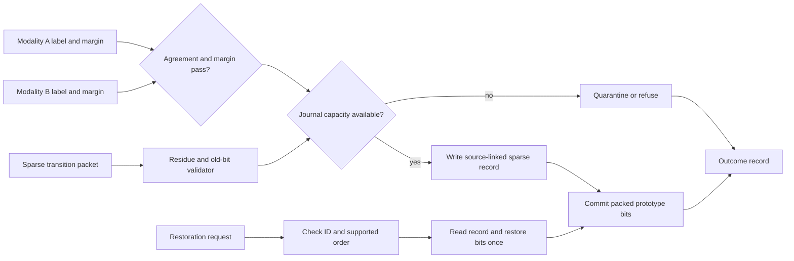

# P3: REVOKE-HDC

## Reversible updates for compact binary HDC prototypes

Eight-week evaluation workbook: `EVALUATION.md` | Decision Log: `docs/decision_log.md` | Friday Metrics: `../friday_metrics.csv`

### Exact Reproduction Command Chain (Weeks 0, 1, 2)

```bash
# Execute entire verified chain in one command:
bash scripts/run_all.sh

# Or step-by-step:
# 1. Setup & Week 0 Foundations
bash scripts/run_week0.sh

# 2. Software Reference & Week 1 Contract Verification
bash scripts/run_week1.sh

# 3. Tests & Negative Suite (Week 2)
python3 tests/test_smallest_w2.py
python3 tests/test_negative_cases.py

# 4. Simulation (1,000-Update Exact Restoration Regression)
python3 tests/test_exact_restoration.py

# 5. Synthesis (Pending Week 3 RTL memories)
# vivado -mode batch -source scripts/build_bitstream.tcl  [PENDING W3]

# 6. Board Run on KV260 (Pending Week 5)
# python3 scripts/run_board_demo.py                      [PENDING W5]

# 7. Summary Figures
python3 scripts/generate_figures.py
```

### The 30-second brief

A hyperdimensional classifier stores each class prototype as a word-packed binary vector. This is efficient for XOR and popcount inference, but the binary bit hides how far the original signed vote count was from the threshold. If an online update later proves unreliable, simply subtracting its hypervector from the packed prototype is not generally correct.

Your system will admit or quarantine source-linked updates, keep a fixed-capacity sparse record of the dimensions that can change threshold state, update the packed prototype, and later restore the exact earlier prototype for the supported revocation order. When storage or update conditions are not valid, it must refuse the update without changing the prototype.

## What you will learn

- HDC encoding, Hamming distance and class prototypes;
- information loss caused by thresholding;
- sparse logs, fixed-capacity admission and exact reversal;
- word-packed memories and bit-level updates;
- source/update identifiers and ordering rules;
- memory break-even and flip-density measurement;
- classification recovery experiments under injected bad updates.

## Core HDC concepts

A bipolar or signed class accumulator contains one signed count per dimension, `c_d`. A compact binary prototype stores only

`b_d = 1 if c_d >= 0, else 0`.

Classification of query hypervector `q` against prototype `p` uses

`Hamming(q,p) = popcount(q XOR p)`.

The smallest distance is the closest class.

### Why thresholding loses information

Counts `c=1` and `c=100` both produce stored bit `1`. Applying update `u=-2` gives:

- `1 + (-2) = -1`, so the bit changes to `0`;
- `100 + (-2) = 98`, so the bit remains `1`.

The packed bit alone cannot predict the result. Any exact update/reversal contract must preserve or receive enough information about the pre-threshold state.

## Minimum supported contract

The core demonstration uses:

- dimension `D >= 4096` on hardware, with a smaller exhaustive model;
- at least two classes;
- 64-bit or wider word-packed prototype memory;
- two independent hypothesis inputs, such as vision and IMU labels with margins;
- a fixed-capacity journal;
- source ID, update ID and class ID;
- exact reversal in reverse commit order for each class;
- explicit refusal when capacity, ordering or residue checks fail.

Reverse-order restoration is the minimum required ordering because it makes dependencies explicit. Arbitrary-order removal is an optional extension and needs a per-dimension version list, replay mechanism or another fully specified dependency method.

## Update packet boundary

The project begins after a candidate update has been formed. For each dimension that may cross threshold, the packet supplies enough information to validate and reverse the packed-bit transition.

| Field | Purpose |
|---|---|
| source ID | associates the update with its source |
| update ID | identifies one commit and later restoration request |
| class ID | selects the packed prototype |
| hypothesis/margin A | first independent modality result |
| hypothesis/margin B | second independent modality result |
| dimension index | identifies an affected bit |
| pre-update residue | bounded signed state before thresholding |
| update contribution | value added to the signed state |
| expected old/new bit | permits packet and memory checks |
| end marker/checksum | closes the variable-length packet |

For each entry, the controller checks:

`old_bit = sign_threshold(pre_residue)`

and

`new_bit = sign_threshold(pre_residue + update_contribution)`.

The stored prototype bit must equal `old_bit` when the packet commits. If it does not, the packet is stale or out of order and must be refused.

## Suggested architecture



## Update admission

Define hypothesis labels `h_A`, `h_B`, margins `m_A`, `m_B`, minimum margins `theta_A`, `theta_B`, required journal bytes `J_req` and free bytes `J_free`.

A simple core rule is:

`admit = (h_A = h_B) AND (m_A >= theta_A) AND (m_B >= theta_B) AND (J_req <= J_free) AND packet_valid`.

You may design a better score or pressure-dependent threshold, but first implement a deterministic rule that can be tested exhaustively.

Refusal or quarantine must not modify the prototype. Quarantine may store the packet outside the active journal for later software inspection, but that storage must not be counted as available restoration capacity.

## Sparse record sizing

Assume:

- `D = 4096`, so a dimension index needs 12 bits;
- at most `F = 96` affected dimensions in one update;
- 4 residue bits per affected dimension;
- 16-byte header containing IDs, class, length, ordering and checksum.

Each affected dimension uses `12 + 4 = 16 bits = 2 bytes`.

- payload: `96 * 2 = 192 bytes`;
- total record: `192 + 16 = 208 bytes`;
- records in 1 MiB: `floor(1,048,576 / 208) = 5,041`.

A complete 4096-bit prototype snapshot uses `512 bytes`. Sparse storage is smaller when

`2F + 16 < 512`,

so

`F < 248`.

Use measured mean, p95 and maximum `F`, not only the mean, when deciding journal capacity.

### Residue width is not a free choice

The residue width and the update alphabet are coupled. A dimension changes its stored bit only when its signed count is already close to the threshold:

- if `c >= 0` and `c + u < 0`, then `0 <= c < |u|`;
- if `c < 0` and `c + u >= 0`, then `-|u| <= c < 0`.

So every affected dimension satisfies `|c| < |u|_max`, and the residue field must represent that whole range:

`residue_bits >= ceil(log2(2 * |u|_max))`.

With 4 signed residue bits the representable range is `-8` to `+7`, which supports `|u|_max <= 8`. Choosing a wider update alphabet without widening the residue produces a design that reverses most updates correctly and fails silently on dimensions whose count sat further from the threshold.

State your chosen `|u|_max` and residue width together in Week 1, and add an assertion that refuses any packet whose contribution exceeds the supported alphabet.

## Exactness and ordering rules

The minimum core must satisfy:

1. An update record is written completely before prototype bits are committed.
2. The commit is visible only after the record is valid and checksummed.
3. Restoration for a class occurs in reverse commit order.
4. Each record changes from `active` to `restoring` to `retired` exactly once.
5. A repeated restoration request returns an already-retired outcome and does not flip bits again.
6. If current prototype bits do not match the record's expected new bits, restoration refuses rather than overwriting newer state.

For an arbitrary-order extension, clearly define how later changes to the same dimension are replayed. Restoring the old bit directly through a newer update is incorrect.

## System invariants

1. Every committed update has a complete valid record.
2. A live journal record is never overwritten.
3. A refused update changes no prototype bit.
4. A successful core restoration reproduces the pre-update prototype bit for bit.
5. Source ID, update ID and class ID match the selected record.
6. One update or restoration changes each listed dimension at most once.
7. Packet checksum or length failure causes refusal.
8. Journal-full behaviour is deterministic and observable.
9. Every update and restoration request creates one outcome record.

## Decisions you must make yourself

1. Which HDC encoder and small dataset will create realistic update packets?
2. What signed residue range and update alphabet are supported?
3. How are duplicate dimension indices in a packet handled?
4. Are entries sorted by dimension, packed by memory word, or accepted in stream order?
5. How are multiple bit changes to one 64-bit prototype word combined safely?
6. What margin/agreement admission rule is used?
7. How does the journal allocate variable-length records?
8. What happens when a record would wrap around the end of a ring?
9. How is reverse-order restoration checked per class?
10. What flip density makes complete snapshots or signed counters preferable?

## Required comparison arms

| Arm | Stored model/update state | Behaviour |
|---|---|---|
| A | full signed counts | update and subtract using complete numeric state |
| B | packed binary prototype only | no restoration support |
| C | full packed-prototype snapshot per accepted update | exact but memory-heavy restoration |
| D | packed prototype plus sparse residue record | proposed compact exact core |

Use identical encoded samples, update order, source labels and restoration requests. Measure exact restoration, bytes per update, journal capacity, update/restoration cycles, refused updates, flip density and classification accuracy before bad update, after bad update and after restoration.

## First 48 hours

1. Read this page and complete the three-paper Week 0 reading: `WEEK_0.md`.
2. Work an 8-dimensional Hamming-distance example by hand.
3. Give three pairs of hidden counts that share one bit but react differently to the same update.
4. Create a tiny packet with two changed dimensions and restore it manually.
5. Choose the core restoration order and write it in one sentence.
6. Create the repository skeleton and a fixed random hypervector seed.
7. List questions about residue width, flip density, packing and journal allocation.

## Detailed weekly plan

### Week 0: Learn HDC and expose threshold information loss

**Goal:** every member can perform Hamming classification and explain why packed bits alone cannot reverse count updates.

**Work to complete:**

- complete the three-paper Week 0 reading: `WEEK_0.md` and reading note;
- implement a small software HDC encoder/classifier;
- draw the path from sample to hypervector to class prototype;
- create threshold-crossing and non-crossing examples;
- select dataset, classes, dimension and deterministic seed;
- freeze the four comparison arms and core restoration order.

**Required evidence:** reading note, hand Hamming example, threshold-loss table, initial software checksum and system diagram.

**Checkpoint:**

- **Green:** every member distinguishes XOR reversibility from threshold information loss.
- **Amber:** classification works but the proposed residue is not yet justified.
- **Red:** the plan stores only changed bits and assumes arbitrary-order restoration is automatically correct.

**Exploration space:** compare bipolar and binary encodings in software, but keep one core format.

### Week 1: Freeze update alphabet, residue and record format

**Goal:** specify exactly what one record can reverse.

**Work to complete:**

- define dimension, classes, word width and bit ordering;
- define signed residue range and update contribution alphabet;
- define packet validation equations;
- define header, entry, checksum and status fields;
- define agreement/margin thresholds;
- define per-class record order and ring allocation;
- calculate record sizes for several `F` values.

**Required evidence:** bit-field tables, ordering state diagram, sizing sheet, at least 30 hand vectors and refusal table.

**Checkpoint:**

- **Green:** another team can decide whether a packet is valid and calculate its required bytes.
- **Amber:** format is complete but ring wrap or duplicate dimensions remain undecided.
- **Red:** the document says “store enough information” without naming the bits.

**Exploration space:** compare dimension-sorted entries with word-grouped entries for memory traffic.

### Week 2: Prove exact restoration in software

**Goal:** establish the exact core before building packed hardware.

**Work to complete:**

- generate valid candidate transition packets from the chosen HDC workload;
- apply agreement/margin and capacity admission;
- commit packed-bit updates and reverse them in supported order;
- compare restored prototype with a saved pre-update reference;
- inject stale old bits, corrupt residue, duplicate IDs and full-journal cases;
- measure flip density over at least 1,000 updates;
- compute mean, p95, maximum and sparse/snapshot break-even frequency.

**Required evidence:** zero-mismatch exact-restoration log, negative tests, flip-density distribution, record-size distribution and reproducible command.

**Checkpoint:**

- **Green:** every admitted core restoration returns the exact pre-update packed prototype.
- **Amber:** exactness holds but generated packet assumptions are not yet documented.
- **Red:** restoration is judged only by recovered accuracy while prototype bits still differ.

**Exploration space:** test a bounded approximate mode separately, reporting Hamming error rather than mixing it with exact results.

### Week 3: Implement packed prototype and journal memories

**Goal:** achieve correct word-packed inference and record storage.

**Work to complete:**

- implement prototype RAM with XOR/popcount read path;
- implement packet parser, duplicate check and checksum;
- implement variable- or fixed-length journal allocation;
- group multiple dimension changes targeting one memory word;
- expose journal head/tail, free bytes and record states;
- assert that prototype commit requires a valid record;
- synthesise and record timing/resources.

**Required evidence:** Hamming result match, packed-word update waveform, journal allocation trace, assertion report and synthesis result.

**Checkpoint:**

- **Green:** inference and accepted prototype updates match software for 10,000 cases.
- **Amber:** memory works but capacity-full or word-collision handling is incomplete.
- **Red:** prototype bits can change before the journal record becomes valid.

**Exploration space:** compare one-cycle wide word updates with a small read-modify-write queue.

### Week 4: Add admission and restoration engine

**Goal:** complete commit, refusal and exact reverse-order restoration.

**Work to complete:**

- implement modality agreement and margin checks;
- reserve journal capacity before accepting a packet;
- commit records and prototype bits in the declared order;
- locate records by source/update/class ID;
- enforce reverse-order restoration per class;
- restore every listed dimension once;
- retire records only after restoration completes;
- implement repeat, stale and out-of-order outcomes.

**Required evidence:** update/quarantine/refusal/restoration waveforms, zero-mismatch regression, exact-once assertions and capacity-state traces.

**Checkpoint:**

- **Green:** accepted updates reverse exactly and invalid ordering never changes a bit.
- **Amber:** one class works but concurrent class journals remain incomplete.
- **Red:** restoration overwrites bits even when current state does not match expected post-update state.

**Exploration space:** try separate per-class heads versus a shared journal with per-class links.

### Week 5: Board integration with injected bad updates

**Goal:** show complete update, classification change and restoration on hardware.

**Work to complete:**

- verify initial prototype and test-set checksums;
- run baseline classification;
- inject accepted, quarantined and journal-full packets;
- apply one controlled bad update and measure its effect;
- issue its restoration request and verify bit-identical prototype recovery;
- replay at least 1,000 deterministic update/restoration operations;
- save all build and board identifiers.

**Required evidence:** board manifest, prototype checksums before/after/restored, mismatch summary, classification table and annotated record trace.

**Checkpoint:**

- **Green:** the restored prototype checksum equals the exact pre-update checksum and the packet path is observable.
- **Amber:** exact bits restore but outcome/record metadata is incomplete.
- **Red:** only software restores state, while hardware reloads a complete saved prototype.

**Exploration space:** vary margin thresholds after the fixed rule passes.

### Week 6: Four-arm memory and recovery campaign

**Goal:** map memory, latency and recovery quality over realistic flip densities.

**Work to complete:**

- freeze encoded samples, update order and bad-source schedule;
- run Arms A to D;
- sweep dimension, flip count, journal size and update rate;
- record exact restoration, Hamming error, bytes/update and cycles;
- measure classification before, after and after restoration;
- plot where sparse records exceed snapshot size;
- report refused updates and journal occupancy over time.

**Required evidence:** raw data, scripts, four-arm table, flip-density plot, memory break-even curve, latency plot and recovery table.

**Checkpoint:**

- **Green:** the team states the precise range where sparse records save memory while retaining exact core restoration.
- **Amber:** memory and exactness are clear but workload generation is not reproducible.
- **Red:** only mean record size is reported and the maximum can overflow unnoticed.

**Exploration space:** compare fixed-size slots with variable-length records under the same byte budget.

### Week 7: Endurance, ordering and corruption stress

**Goal:** verify that record pressure and repeated requests never silently damage prototypes.

**Work to complete:**

- fill the journal, wrap it and retire records repeatedly;
- issue duplicate, stale, corrupt-checksum and out-of-order requests;
- reset during record write, prototype commit and restoration;
- stall the prototype or outcome interfaces;
- run long mixed-class update streams;
- have another team reproduce one full-journal refusal and exact restoration;
- audit every live record against current class history.

**Required evidence:** endurance log, ring-state plots, fault matrix, assertion report, checksum audit and independent reproduction note.

**Checkpoint:**

- **Green:** all stress cases end in an explicit status and no unrecorded bit change.
- **Amber:** corruption is detected but one reset phase requires discarding the latest packet.
- **Red:** ring wrap can overwrite a record that remains active.

**Exploration space:** add a checkpoint/replay experiment only after the reverse-order core is stable.

### Week 8: Freeze and hand over

**Goal:** make the complete update and restoration story reproducible.

**Work to complete:**

- freeze encoder seed, dataset split, packet generator and hardware configuration;
- provide one-command model, simulation, board and figure runs;
- document the supported restoration order and all limits prominently;
- prepare diagrams for packed memory, journal allocation and update states;
- annotate one update-to-restoration trace;
- run a clean independent reproduction;

**Required evidence:** final manifest, evidence index, reproduction log, final figures, test report and demonstration checklist.

**Checkpoint:**

- **Green:** a new reader reproduces one accepted update and exact restoration without verbal help.
- **Amber:** results are complete but packet generation needs one undocumented manual step.
- **Red:** the demonstration depends on a hidden complete prototype snapshot.

**Exploration space:** document arbitrary-order restoration as a future experiment with its required dependency state.

## Required figures

1. Packet admission, record write, prototype commit and restoration timeline.
2. Flip-count distribution with mean, p95 and maximum.
3. Bytes per update versus flip count, with snapshot line.
4. Journal occupancy and refusals over time.
5. Update/restoration cycles versus affected dimensions.
6. Accuracy and prototype Hamming distance before bad update, after it and after restoration.

## Common failure modes

- assuming majority thresholding can be undone with XOR;
- storing only a flip flag for an ordering contract that needs residue/dependency state;
- changing prototype bits before the record is durable and valid;
- overwriting active records during ring wrap;
- restoring through a newer overlapping update;
- using accuracy recovery as a substitute for bit-identical exactness;
- omitting headers and metadata from break-even calculations;
- allowing duplicate dimension entries to toggle a bit twice.

## Final handover checklist

- [ ] HDC dimension, seed, class and bit ordering are frozen.
- [ ] Residue and update alphabet are explicit.
- [ ] Supported restoration order is enforced.
- [ ] Prototype commit requires a complete valid record.
- [ ] Refusal/quarantine changes no prototype bit.
- [ ] Exact core restoration is bit-identical.
- [ ] Journal-full, wrap and reset behaviours are tested.
- [ ] Memory sizing includes headers and metadata.
- [ ] Arms A to D use identical update streams.
- [ ] Another student reproduced exact restoration.

## Freedom to improve the design

You may improve packet grouping, journal allocation, admission thresholds or dependency handling. Keep exact and approximate modes separate, preserve explicit ordering, and verify every proposed improvement first with a small exhaustive state model. A simpler system with clear limits and exact evidence is preferable to a broad system with ambiguous restoration.

## Frozen configuration for this cohort

To keep an eight-week schedule reproducible, this cohort builds one fixed configuration rather than exploring the full design space in `README.md` at once. Treat every row below as fixed unless a Week 1 measurement gives a specific reason to revisit it, and record any change in the project decision log.

| Item | Fixed value | Reason |
|---|---|---|
| Dimension `D` | 4096 | Fixes the dimension-index width at 12 bits and the packed-prototype size at 512 bytes/class, so every sizing calculation in this README stays exact |
| Word width | 64-bit packed words | One word-packed memory layout and one read-modify-write path halves the RTL and verification surface compared with supporting several widths |
| Class count | 4 | Enough classes to exercise per-class journal heads and cross-class isolation without the resource and verification cost of a large class count |
| Independent hypothesis inputs | 2 (vision-style and IMU-style labels with margins) | Matches the two-modality agreement check in "Update admission"; a single modality cannot exercise that logic at all |
| Residue width | 4 bits, signed, range `-8` to `+7` | The smallest width that satisfies `residue_bits >= ceil(log2(2*|u|_max))` for a useful update magnitude, and keeps each journal entry at exactly 2 bytes (index + residue) |
| Update alphabet | `\|u\|_max <= 8` | Coupled to the residue width above; a packet whose contribution exceeds this is refused rather than silently mis-restored later |
| Maximum affected dimensions per update (`F`) | 96 | Matches the worked sizing example in "Sparse record sizing", so every number quoted through Week 6 is reproducible, and keeps one packet's parse time bounded |
| Journal header | 16 bytes: source ID, update ID, class ID, sequence, hypothesis/margin pair, length, checksum | A fixed field layout makes record size a simple function of `F` alone |
| Journal structure | Fixed-capacity ring buffer in BRAM with head/tail/free-byte counters and one record-chain head per class | Makes capacity and per-class ordering directly observable on the status registers instead of inferred from memory contents |
| Record-before-commit ordering | Enforced by physically withholding the prototype write-enable until the journal reports the record durable and checksummed | Turns "no update without a record" into a wiring fact checkable with a single assertion, not a convention that software could bypass |
| Restoration order | Reverse commit order only, per class | The only ordering that can be checked with a single per-class head pointer; arbitrary-order removal needs a per-dimension version list or replay mechanism this cohort does not have time to build and verify in eight weeks |
| Record state machine | `active -> restoring -> retired`, each transition exactly once | Gives every record an explicit, observable lifecycle and makes a repeated restoration request detectable without a second bit flip |
| Packet framing | Fixed header, then entries, then checksum, closed by a length field | Lets the parser detect a truncated or malformed packet before touching any journal or prototype state |
| Refusal outcomes | Exactly seven named reasons (capacity, checksum, residue, stale, duplicate, ordering, bit-state), plus quarantine, accept and restore | Turns every rejected request into one of a small, testable set of outcomes that Week 7's stress testing can check against |

### Out of scope for this cohort

- Arbitrary-order restoration. It needs a per-dimension version list or a fully specified replay mechanism; keep it as a documented future exploration only, per "Freedom to improve the design".
- Pressure-dependent or learned admission thresholds. Start from the fixed deterministic rule in "Update admission" and only vary thresholds after that rule passes.
- More than 4 classes or more than 2 modalities in the core demonstration.
- Word widths other than 64 bits, or dimension counts other than 4096, as alternative configurations.
- A bounded approximate restoration mode mixed into the same reported results as the exact core; report any approximate-mode experiment separately, per the Week 2 exploration space.
- Variable-length record sophistication beyond the fixed slot layout chosen in Week 1.
- Counting quarantine storage toward available restoration capacity.
