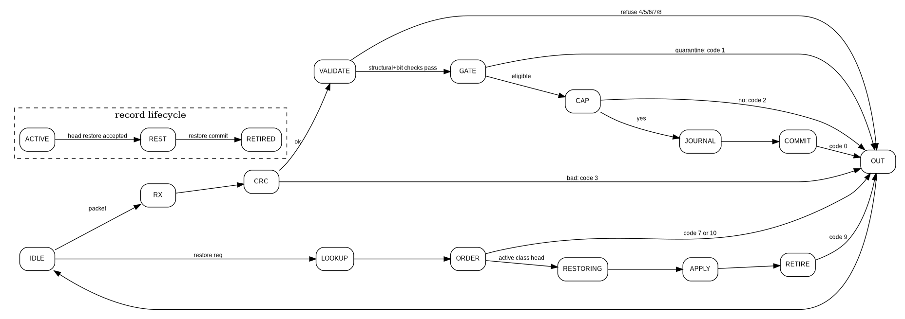

# Ordering and Record Lifecycle - W1-R1

## Record lifecycle

`ACTIVE -> RESTORING -> RETIRED`

- **ACTIVE:** accepted update is fully journaled and is eligible for later restoration.
- **RESTORING:** controller has verified update ID and class-head ordering and has locked the record against a second restore.
- **RETIRED:** old bits have been applied once; repeated restore requests return `already-retired` (10) while the tombstone remains indexable.

## Reverse-commit-order rule

Each of the four classes owns a head pointer to its newest ACTIVE record. Only that record may be restored. This makes the supported undo order LIFO **within each class**, while updates to different classes remain independently chained.

## R1 controller path

The state diagram in this package follows the supplied Week 1 architecture flow and gives concrete R1 labels for receive, CRC, validation, gate, capacity, journal, commit and restoration phases. The supplied `WEEK_1.md` references `PROJECT_PLAN.md` Section 3.3 but that file was not uploaded, so the exact Section 3.3 state names cannot be verified here. If the plan uses different names, rename the states without changing the ordering/atomicity contract.

## Ring allocation and wrap

Journal records do not split across the ring boundary. Let `R=16+2F`. If the write pointer has fewer than `R` bytes remaining before the physical end, those trailing bytes are skipped/padded and allocation restarts at offset 0 only if the requested contiguous span does not overlap live data. This simplifies DMA/BRAM addressing and makes a record readable with one contiguous base+length pair.
