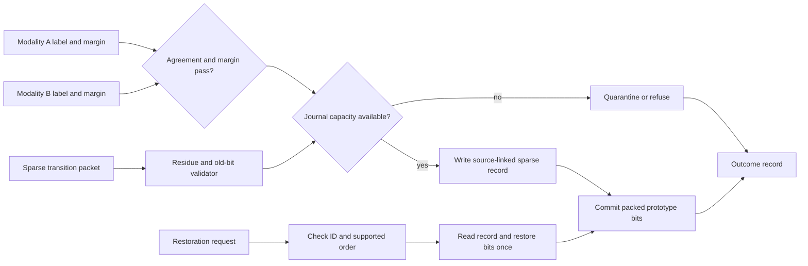

# P3 REVOKE-HDC: Week 1 — Freeze update alphabet, residue and record format

This week turns the README's packet fields and the plan's frozen widths into a single written record and refusal contract that every later week builds and measures against, without writing simulator or RTL code yet.

Read before you start: `README.md` "### Week 1: Freeze update alphabet, residue and record format" and `PROJECT_PLAN.md` "4. Interface and record contract" and "10. Risks and open decisions to close in Week 1". Record the Friday review in `EVALUATION.md` "Week 1 evaluation".

## Goal

**Goal** (`README.md`): "specify exactly what one record can reverse." Concretely, nobody starts the software reference model or RTL this week. `PROJECT_PLAN.md` Section 4 already fixes the wire-packet header (16 bytes), the per-entry payload (3 bytes) and the persisted journal record (16-byte header plus 2 bytes per affected dimension). This week confirms those frozen numbers against the team's actual chosen encoder and dataset, closes the sixteen open items in `PROJECT_PLAN.md` Section 10, and states plainly that the design restores the packed prototype *bit* — recomputed as `sign_threshold(residue)` from the retained residue — and never reconstructs the original hidden signed count; only Arm A keeps full counts, and Arm A is out of scope for the journal design itself.

## The flow this contract must support

Reproduced from `README.md` "Suggested architecture" — this week's tables must be complete enough that every arrow below can be named with a concrete field:

## Frozen packet, record and outcome fields

Reproduced here for convenience from `PROJECT_PLAN.md` Section 4.1 and 4.5, so the team checks its own tables against these rather than retyping them from memory.

Wire-packet header, 16 bytes, host to controller:

| Field | Width | Notes |
|---|---|---|
| `source_id` | 8 bits | identifies the sending modality/harness |
| `update_id` | 16 bits | monotonic, identifies this update for a later restoration request |
| `class_id` | 8 bits (2 used, 6 reserved) | selects one of 4 prototypes |
| `sequence` | 16 bits | per-class monotonic count, cross-checked against the index-table chain at admission |
| `hA`, `mA` | 8 bits, 8 bits | modality-A hypothesis label and margin |
| `hB`, `mB` | 8 bits, 8 bits | modality-B hypothesis label and margin |
| `entry_count` (`F`) | 8 bits (0-96 used) | number of affected-dimension entries that follow |
| `length` | 16 bits | total packet length in bytes, header plus payload plus checksum |
| `reserved/format` | 8 bits | format version, zero in the frozen build |
| `checksum` | 16 bits | CRC-16 over header and payload, closes the packet |

Per-entry wire payload, 3 bytes, repeated `F` times (`F <= 96`):

| Field | Width | Notes |
|---|---|---|
| `dimension_index` | 12 bits | `0..4095` |
| `pre_update_residue` | 4 bits, signed | range `-8..+7` |
| `update_contribution` | 4 bits, signed | magnitude asserted `<= 8` at parse time |
| `expected_old_bit` | 1 bit | sender's claimed `sign_threshold(pre_update_residue)` |
| `expected_new_bit` | 1 bit | sender's claimed `sign_threshold(pre_update_residue + update_contribution)` |
| reserved | 2 bits | zero |

The persisted journal record reuses the 16-byte header unchanged, then discards `update_contribution` and both expected-bit fields once the parser has checked them, keeping only a 2-byte entry (12-bit `dimension_index` plus 4-bit signed `residue`) per affected dimension — the old bit is always recoverable later as `sign_threshold(residue)`, so nothing else needs to be kept.

Outcome codes (`PROJECT_PLAN.md` Section 4.5), all eleven values this week's refusal table must name:

| Code | Meaning | Prototype changed? |
|---:|---|---|
| 0 | accepted | yes |
| 1 | quarantined | no |
| 2 | refused - capacity | no |
| 3 | refused - checksum | no |
| 4 | refused - residue (includes alphabet exceeded) | no |
| 5 | refused - stale | no |
| 6 | refused - duplicate | no |
| 7 | refused - ordering | no |
| 8 | refused - bit-state | no |
| 9 | restored | yes (reverted) |
| 10 | already-retired (repeat restoration request) | no |

## What must exist by Friday

1. The bit-field tables above, confirmed against the team's own encoder and copied into `docs/`, mirrored as a versioned parameter file in `configs/`.
2. The packet validation equations written out in `docs/`: `old_bit = sign_threshold(pre_residue)` and `new_bit = sign_threshold(pre_residue + update_contribution)`, plus the admission-time rule that a recomputed `old_bit` must equal the currently stored prototype bit or the packet is refused as stale.
3. Closed answers, recorded in `docs/decision_log.md`, for every item in `PROJECT_PLAN.md` "10. Risks and open decisions to close in Week 1":
   - [ ] Confirm the encoder and dataset choice (README line 184) — the team's own domain decision, not pre-frozen by the plan.
   - [ ] Check the frozen residue range (4 bits signed) and `|u|_max <= 8` alphabet against the real encoder's typical per-dimension contribution; record the check, not just the frozen number.
   - [ ] Confirm duplicate dimension indices within one packet are refused as `refused_duplicate` (already frozen; record the confirmation).
   - [ ] Decide entry ordering — dimension-sorted, word-grouped or stream order; the plan defaults to stream order with write-mask combining and this may be revisited after Week 1 since it affects traffic pattern, not correctness.
   - [ ] Confirm the write-mask rule that combines every entry landing in the same 64-bit word into one cycle group (already frozen; record the confirmation).
   - [ ] Calibrate `theta_A` and `theta_B` against the chosen encoder; `theta_A=theta_B=128` in `PROJECT_PLAN.md` Section 8.2 is illustrative only.
   - [ ] Confirm the ring-buffer-plus-record-index-table journal allocation (already frozen; record the confirmation).
   - [ ] Decide ring-wrap behaviour: whether a record may split across the wrap point, or the allocator pads to the ring end and restarts at offset 0 — genuinely open per `PROJECT_PLAN.md` Section 10.
   - [ ] Confirm the per-class head-pointer check for reverse-order restoration (already frozen; record the confirmation).
   - [ ] Record the `F < 248` break-even formula; the measured `F` for the real workload stays an open empirical question for Week 6, not this week.
   - [ ] Set the target clock frequency and expected packets/second for the PL region.
   - [ ] Size total journal BRAM capacity in bytes, against a planned Week 1/2 measured `F` distribution rather than the mean alone.
   - [ ] Fix the record index table depth `N` (maximum simultaneously live records across all 4 classes), which sets the `slot_id` width.
   - [ ] Fix the trace buffer depth needed to hold one full Section 8 demonstration run without overwriting unread records.
   - [ ] Choose the CRC-16 polynomial for the packet and record checksum field.
   - [ ] Fix the AXI-Lite base address and interconnect integration point against the Zynq UltraScale+ processing system on the KV260 build.
4. An ordering state diagram in `docs/` showing the record lifecycle `active -> restoring -> retired` and the controller states of `PROJECT_PLAN.md` Section 3.3, redrawn from the plan rather than invented.
5. A sizing sheet in `docs/` reproducing `16 + F*2` bytes for at least `F=40`, `F=96` and `F=247`/`F=248`, showing the `2F + 16 < 512` break-even test explicitly.
6. At least 30 hand-checked vectors in `tests/`, each a `(residue, contribution)` pair with its worked `old_bit`/`new_bit` and an explicit accept/refuse verdict against the frozen alphabet.
7. The outcome-code table above, copied into `docs/` as the refusal table, with each of the 7 refusal codes, `quarantined`, `accepted` and `restored` given a one-line trigger condition specific to this project.

## Day by day

| Day | What this means for Week 1 |
|---|---|
| Monday | Freeze the week's question ("what can one record prove and reverse?"), name the system owner as lead (`PROJECT_PLAN.md` Section 7, W1) with roles still rotating per the root README, and state the pass condition: another team can validate a packet and compute its byte count from the written tables alone. |
| Tuesday | Build and verify the residue/alphabet table and the header/entry bit-field tables above against the team's own encoder; work the `F=40 -> 96` bytes and `F=96 -> 208` bytes sizing examples by hand. |
| Wednesday | Integrate the bit-field tables with the refusal table and the ordering state diagram; retain the first hand vector that comes out wrong (for example, a residue/contribution pair that looks valid but exceeds `|u|_max<=8`) rather than discarding it. |
| Thursday | Run the frozen checkpoint against the README's Week 1 Green/Amber/Red criteria; produce at least 30 checked hand vectors and the sizing sheet as evidence; the reproducer countersigns the notebook. |
| Friday | 12-minute evaluation against `EVALUATION.md` "Week 1 evaluation": maximum supported record size, the closed Section 10 checklist, and the refusal table. |

## Acceptance criteria

- [ ] A team with no verbal access to the authors can decide, from the written tables alone, whether a sample packet is valid and its required byte count (`PROJECT_PLAN.md` Section 7, W1).
- [ ] At least 30 hand-checked vectors pass the residue/alphabet rule (`PROJECT_PLAN.md` Section 7, W1; `README.md` Week 1 required evidence).
- [ ] The refusal table lists all 7 outcome codes with a trigger condition each (`PROJECT_PLAN.md` Section 7, W1; Section 4.5).
- [ ] The `F=40` record size hand-computes to `16 + 2*40 = 96` bytes (`PROJECT_PLAN.md` Section 7, W1 smallest test).
- [ ] The `F=96` record size hand-computes to `208` bytes, and the break-even inequality `2F + 16 < 512` is shown to hold for `F < 248` (`README.md` "Sparse record sizing"; `PROJECT_PLAN.md` Section 4.2).
- [ ] The team's copied wire-packet header, per-entry payload and outcome-code tables match `PROJECT_PLAN.md` Section 4.1 and 4.5 exactly in field names and widths, with any deliberate deviation recorded, not silent.
- [ ] All sixteen items in `PROJECT_PLAN.md` Section 10 carry a recorded answer — a confirmed frozen value or an explicit open decision with an owner — in `docs/decision_log.md`.
- [ ] Numeric result for `EVALUATION.md` "Week 1 evaluation" — maximum supported record size in bytes — is filled in and matches the sizing sheet.

## Evidence to retain

This week produces documents and hand vectors, not timed runs, so most `METRICS_GUIDE.md` experiment columns (`arm`, `metric_name`, `golden_match`, `bitstream_sha`, `board_serial`) do not yet apply. Still open one `manifests/` entry recording `run_id`, `date_utc`, `team=P3`, `project=REVOKE_HDC` and `source_commit` against the frozen document set, per the root README's "Freeze before measuring" rule, so every later week can cite exactly which revision of the packet and record contract it built against. Keep every hand vector in `tests/`, including any that first came out wrong — a corrected vector is exactly the kind of retained failure the root README's "Keep failed runs" rule describes, and it is usually the clearest evidence for why the residue field is load-bearing and not a convenience.

## Friday review

- [ ] Numeric result recorded: maximum supported record size in bytes, matching the `16 + F*2` sizing sheet.
- [ ] Main run/document ID(s) recorded for the frozen document set and the 30-vector test file.
- [ ] Source commit/build ID recorded against the frozen tables.
- [ ] Reference match stated (y/n/bounded) for the hand vectors against the residue/alphabet rule.
- [ ] What did not work this week recorded, even if it is only a vector that needed correcting.
- [ ] Cross-check performed by someone who did not write the tables, confirmed and named.
- [ ] Team verdict (Green/Amber/Red) recorded against the README Week 1 checkpoint language.
- [ ] Next smallest test and owner agreed: build one hand-built 2-entry packet and restore it in the software model (`PROJECT_PLAN.md` Section 7, W2 smallest test).

## Where this usually goes wrong

- Writing "store enough information to reverse the update" without naming the actual bits — the README's own Week 1 Red checkpoint. The residue width and header layout must be numbers, not a sentiment.
- Leaving ring-wrap behaviour undecided past Friday. `PROJECT_PLAN.md` Section 10 flags this as genuinely open, and Week 7's stress suite depends on the answer already existing.
- Widening the update alphabet without widening the residue field to match. `README.md` "Residue width is not a free choice" shows this produces a design that reverses most updates and fails silently on the rest.
- Omitting the 16-byte header from the break-even calculation, which makes `F < 256` look right instead of the correct `F < 248`.
- Treating duplicate dimension indices as a Week 3 RTL problem instead of a Week 1 contract decision; the refusal table must name `refused_duplicate` now even though nothing enforces it yet.

## Hand-off into Week 2

Week 2's software reference model consumes this week's frozen residue width, update alphabet, header/entry fields and reverse-commit-order rule directly as its data model — it has nothing else to simulate against. The closed Section 10 checklist, especially the ring-wrap decision and the calibrated `theta_A`/`theta_B` values, becomes the admission and journal-allocation logic Week 2 implements in software before any RTL is written.
