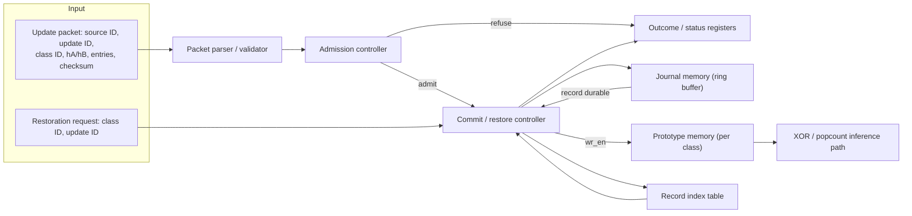

# P3 REVOKE-HDC: Week 3 — Implement packed prototype and journal memories

This week builds the RTL prototype memory with its XOR/popcount read path and the BRAM journal ring, and proves both match the Week 2 software reference before the admission and restoration engine sits on top of them.

Read before you start: `README.md` "### Week 3: Implement packed prototype and journal memories" and `PROJECT_PLAN.md` "3. Frozen architecture". Record the Friday review in `EVALUATION.md` "Week 3 evaluation".

## Goal

**Goal** (`README.md`): "achieve correct word-packed inference and record storage." Concretely, this week implements the storage half of `PROJECT_PLAN.md` Section 3.1's seven modules — prototype memory and journal memory — plus the packet parser and record index table that feed them. Nothing here yet decides admission or drives restoration; this week's contract is that inference and any accepted prototype write already agree with Week 2's software model.

## System block diagram this week builds toward

Reproduced from `PROJECT_PLAN.md` Section 3.2 — this week's four modules are the boxes without a `CTRL` label; the commit/restore controller itself is Week 4's work:

## Modules built this week

Reproduced from `PROJECT_PLAN.md` Section 3.1, the module rows this week owns:

| Module | Function | Key registers / RAM / counters |
|---|---|---|
| Packet parser / validator | Frames one incoming update packet, recomputes `old_bit`/`new_bit` per entry from residue and contribution, checks length and checksum, rejects duplicate dimension indices within the packet | Entry counter; running checksum accumulator; 96-bit duplicate-index scoreboard |
| Prototype memory | One packed BRAM per class, 64 words of 64 bits (`D=4096`); XOR/popcount read path for inference; masked read-modify-write for commit and restore | 256 words total (64 x 4 classes); `wr_mask[63:0]` |
| Journal memory | Byte-addressable append-only ring buffer in BRAM holding 16-byte record headers plus 2 bytes per affected dimension | `head_ptr[19:0]`, `tail_ptr[19:0]`, `free_bytes[19:0]` |
| Record index table | Fixed-depth register file, one row per simultaneously live record slot; carries the state field and the reverse-order chain pointer per class | Per slot: `ring_offset[19:0]`, `length[11:0]`, `class_id[1:0]`, `state[1:0]`, `prev_slot`, `update_id[15:0]` |

The admission controller and the commit/restore controller that read and write these four modules are Week 4's work, not this week's; this week proves the memories are correct in isolation and under a direct, already-admitted write.

## Status registers this week's memories must expose

From `PROJECT_PLAN.md` Section 4.6 — the four read-only registers whose values come directly from the modules this week builds, ahead of the full register map Week 4-5 complete:

| Offset | Name | Meaning |
|---|---|---|
| `0x10` | `JOURNAL_FREE_BYTES` | current `free_bytes` counter |
| `0x14` | `JOURNAL_HEAD_OFFSET` | ring head pointer |
| `0x18` | `JOURNAL_TAIL_OFFSET` | ring tail pointer |
| `0x2C` | `PROTOTYPE_CHECKSUM` | CRC-32 of the selected class's packed prototype, latched on read |

## What must exist by Friday

1. Prototype RAM in `src/` for all 4 classes (256 words of 64 bits total) with the XOR/popcount read path from `README.md` "Core HDC concepts": `Hamming(q,p) = popcount(q XOR p)`.
2. A packet parser in `src/` matching the module row above, using the Week 1 CRC-16 polynomial decision.
3. Journal memory in `src/`: the ring buffer with `head_ptr`, `tail_ptr` and `free_bytes` counters, storing the 16-byte header plus 2 bytes per affected dimension per `PROJECT_PLAN.md` Section 4.2.
4. A record index table in `src/` matching the module row above, sized to the Week 1 `N` decision.
5. Write-mask combining logic in `src/` so that multiple entries landing in the same 64-bit prototype word commit in a single cycle group (`wr_mask[63:0]`).
6. The four status registers above wired to their source counters, even before the rest of the Section 4.6 map exists.
7. An assertion for Invariant 1 in `tests/` — the prototype write-enable (`wr_en_out`) never asserts before the state machine reaches `COMMIT` or `RESTORE_APPLY` — present in simulation and never firing.
8. An assertion or scoreboard for Invariant 2 in `tests/` — a journal record becomes `active` strictly before the first prototype write of the same request.
9. A synthesis run targeting the KV260 #2 part, using timing/pin constraints in `constraints/`, with timing and resource reports recorded in `results/raw/` and `docs/`.

## Day by day

| Day | What this means for Week 3 |
|---|---|
| Monday | Freeze the week's question — "does packed inference and accepted-update commit match the software reference bit for bit?" — name the hardware owner as lead (`PROJECT_PLAN.md` Section 7, W3), pass condition: 10,000-case match against Week 2's model. |
| Tuesday | Build and verify the prototype memory's XOR/popcount read path alone against a batch of Week 2 software queries, with no journal or write path connected yet. |
| Wednesday | Integrate the packet parser, journal ring and write-mask combining logic; retain the first read-modify-write collision (two entries in the same word within one packet) that comes out wrong before fixing it. |
| Thursday | Run the frozen 10,000-case checkpoint against the software reference, plus the Invariant 1 and Invariant 2 assertions and the synthesis timing/resource run; prepare the Hamming-result comparison and waveform trace as evidence. |
| Friday | 12-minute evaluation against `EVALUATION.md` "Week 3 evaluation": packed inference mismatches (numerator/denominator), the assertion report and the synthesis result. |

## Acceptance criteria

- [ ] RTL inference and accepted prototype updates match the software reference for at least 10,000 cases (`PROJECT_PLAN.md` Section 7, W3; `README.md` Week 3 Green checkpoint).
- [ ] The design closes timing at the target clock with a recorded resource report (`PROJECT_PLAN.md` Section 7, W3).
- [ ] The Invariant 1 assertion (`wr_en_out` only after `COMMIT` or `RESTORE_APPLY`) is present in the testbench and never fires (`PROJECT_PLAN.md` Section 5, Invariant 1; Section 7, W3).
- [ ] The Invariant 2 scoreboard (record durable strictly before the first prototype write for the same request) shows no ordering inversion (`PROJECT_PLAN.md` Section 5, Invariant 2).
- [ ] `JOURNAL_FREE_BYTES`, `JOURNAL_HEAD_OFFSET`, `JOURNAL_TAIL_OFFSET` and `PROTOTYPE_CHECKSUM` read back correct values for at least one directed sequence.
- [ ] One accepted update whose entries all map to a single 64-bit word commits correctly and matches the software model (`PROJECT_PLAN.md` Section 7, W3 smallest test).
- [ ] No dimension is written twice within a single commit — the parser-side duplicate check and Invariant 10 both hold on at least one multi-entry same-word test case (`PROJECT_PLAN.md` Section 5, Invariant 10).
- [ ] Numeric result for `EVALUATION.md` "Week 3 evaluation" — packed inference mismatches, as a fraction — is `0` out of at least 10,000 cases.

## Evidence to retain

Open one `manifests/` entry per synthesis run, recording `run_id`, `date_utc`, `team=P3`, `project=REVOKE_HDC`, `source_commit`, `dirty_tree` and, from this week on, `bitstream_sha` for the synthesised build (board bring-up itself is still Week 5, so `board_serial` does not yet apply). Record post-implementation `lut`, `ff`, `dsp`, `bram36`, `fmax_mhz` and `wns_ns` in `results/raw/` per `METRICS_GUIDE.md` "Implementation fields", leaving genuinely unavailable fields empty rather than zero. Use `inst_queue_depth` for journal bytes or records used and `inst_coalesced` for affected dimensions, per the P3 row in `METRICS_GUIDE.md` "Shared instrumentation columns". Keep the trace of any read-modify-write collision that first misbehaved in `results/raw/`, not just the corrected version.

## Friday review

- [ ] Numeric result recorded: packed inference mismatches, as a fraction (target `0 / >=10,000`).
- [ ] Main run ID(s) recorded for the 10,000-case regression and the synthesis run.
- [ ] Source commit/build ID recorded, matching the `bitstream_sha` in the manifest.
- [ ] Reference match stated (y/n/bounded) against the Week 2 software model.
- [ ] What did not work this week recorded, including any same-word collision or capacity-full case not yet handled.
- [ ] Cross-check performed by someone who did not write the RTL, confirmed and named.
- [ ] Team verdict (Green/Amber/Red) recorded against the README Week 3 checkpoint language.
- [ ] Next smallest test and owner agreed: issue a restoration request one commit out of order and confirm `refused_ordering` with the prototype unchanged (`PROJECT_PLAN.md` Section 7, W4 smallest test).

## Where this usually goes wrong

- Letting prototype bits change before the journal record becomes valid — the README's own Week 3 Red checkpoint, and exactly what Invariant 1 and Invariant 2 exist to catch.
- Handling capacity-full or same-word write collisions only in the common case, leaving the Amber checkpoint's "capacity-full or word-collision handling is incomplete" gap open into Week 4.
- Overwriting a live record during ring wrap because the allocator does not yet check slot state before writing — this is Invariant 8, and the Week 1 wrap decision must actually be wired in, not just documented.
- Treating the CRC-16 checksum as a formality instead of gating parse success; a packet that fails checksum must reach `REFUSE` before touching the journal.
- Building the record index table's `slot_id` width from a guess instead of the Week 1 `N` decision, forcing a re-spin once the real number of simultaneously live records is known.

## Hand-off into Week 4

Week 4's admission controller and commit/restore controller sit directly on top of this week's prototype memory, journal memory and record index table — Week 4 adds no new storage, only the state machine and the modality/margin checks that decide when those memories are written. The synthesis timing and resource numbers from this week become the baseline Week 4's larger state machine is checked against, so the added control logic does not silently break the closed-timing result.
