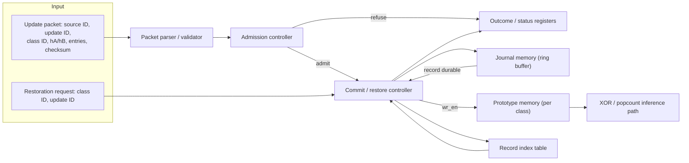

# P3 REVOKE-HDC: Week 8 — Freeze and hand over

This week freezes every configuration choice, documents every limit, and proves the whole update-and-restoration story reproduces for a reader who was not on the team.

Read before you start: `README.md` "### Week 8: Freeze and hand over" and `PROJECT_PLAN.md` "8. Final demonstration script" and "9. Required diagrams and figures". Record the Friday review in `EVALUATION.md` "Week 8 evaluation".

## Goal

**Goal** (`README.md`): "make the complete update and restoration story reproducible." Concretely, nothing new is designed this week. The encoder seed, dataset split, packet generator and hardware configuration used throughout Weeks 5-7 are frozen exactly as tested; the six required diagrams are redrawn as clean line diagrams; the supported restoration order and every stated limit (reverse-commit-order only, `F<=96`, `\|u\|_max<=8`, and the out-of-scope items in the README's "Frozen configuration for this cohort") are documented prominently; and one full update-to-restoration trace is annotated end to end.

## System block diagram Fig.1 must match

Reproduced from `PROJECT_PLAN.md` Section 3.2 — the working reference this week's Fig.1 redraw is checked against, not a new drawing invented from memory:

## Required diagrams to redraw

Reproduced from `PROJECT_PLAN.md` Section 9 — all six satisfy `README.md` "Required figures" and must be clean black-and-white line drawings before freeze, not left as hand sketches or raw waveform screenshots:

| Figure | What it must show |
|---|---|
| Fig.1 — system block diagram | Every module (parser, admission controller, prototype memory, journal memory, record index table, commit/restore controller, outcome/status registers) as a labelled box with data-flow arrows, and the AXI-Lite boundary to the host, matching the diagram above |
| Fig.2 — controller state diagram | Every state as a node, every transition as a labelled arrow carrying its condition, with every refusal exit marked with its outcome code |
| Fig.3 — datapath diagram | The bit-level path from one packet entry to one prototype bit: dimension-index decode, the sign-threshold comparator, the stored-bit compare, and write-mask generation, with every signal's width labelled |
| Fig.4 — accepted-path timing diagram | Cycle-by-cycle waveform for Section 8.2, showing `wr_en_out` only ever rising after `record_durable` |
| Fig.5 — refused-path timing diagram | The same waveform style for Section 8.4's out-of-order restoration attempt, showing `wr_en_out` held low for the entire request |
| Fig.6 — four-arm results | Bytes-per-update against `F` for all four arms with the 512-byte snapshot line and the `F=248` break-even point marked, plus classification accuracy at the four Section 8 measurement points, per arm |

## What must exist by Friday

1. A frozen encoder seed, dataset split, packet generator and hardware configuration, recorded in `configs/` and referenced by `source_commit` in the final manifest.
2. One-command model, simulation, board and figure runs, implemented in `scripts/` and matching the command list the project `README.md` has shown since Week 1 (`setup -> software reference -> tests -> simulation -> synthesis -> board run -> figures`).
3. The supported restoration order (reverse commit order, per class only) and every limit from the README's "Frozen configuration for this cohort" and "Out of scope for this cohort" sections, documented prominently in the project `README.md`.
4. All six diagrams from the table above, redrawn as clean black-and-white line diagrams in `docs/`.
5. One update-to-restoration trace, annotated end to end from a `TRACE_POP` dump, in `results/processed/`.
6. A final manifest, evidence index, reproduction log, final figures and test report in `manifests/` and `results/`.
7. A demonstration checklist in `docs/` covering the accepted path and the refused/failed path, per the root README's common completion standard.
8. The project's own "Final handover checklist" (`README.md`), closed item by item and recorded in `docs/`:
   - [ ] HDC dimension, seed, class and bit ordering are frozen.
   - [ ] Residue and update alphabet are explicit.
   - [ ] Supported restoration order is enforced.
   - [ ] Prototype commit requires a complete valid record.
   - [ ] Refusal/quarantine changes no prototype bit.
   - [ ] Exact core restoration is bit-identical.
   - [ ] Journal-full, wrap and reset behaviours are tested.
   - [ ] Memory sizing includes headers and metadata.
   - [ ] Arms A to D use identical update streams.
   - [ ] Another student reproduced exact restoration.
9. A clean, independent reproduction run: a student outside the team runs one smoke test from the project `README.md` without verbal help, and the result is recorded.

## Day by day

| Day | What this means for Week 8 |
|---|---|
| Monday | Freeze the week's question — "does a reader outside the team reproduce one accepted update and its exact restoration from the README alone?" — name the system owner as lead (`PROJECT_PLAN.md` Section 7, W8), pass condition: that reproduction succeeds with no hidden step. |
| Tuesday | Build and verify the one-command flows (setup through figures) end to end from a clean checkout, before inviting anyone outside the team to run them. |
| Wednesday | Integrate the six redrawn diagrams and the documented limits into the project `README.md`; retain the first place a new reader gets stuck (an undocumented flag, an assumed working directory) and fix the documentation rather than explaining it verbally. |
| Thursday | Run the frozen one-command sequence and the annotated trace generation; prepare the final manifest, evidence index and test report as evidence. |
| Friday | 12-minute evaluation against `EVALUATION.md` "Week 8 evaluation": external restoration error in bits, the evidence index and the external exact-restoration result, plus the "Week 8 close-out" checklist. |

## Acceptance criteria

- [ ] A new reader reproduces one accepted update and its exact restoration using only the README and `PROJECT_PLAN.md`, without verbal help (`PROJECT_PLAN.md` Section 7, W8; `README.md` Week 8 Green checkpoint).
- [ ] The demonstration depends on no hidden full-prototype snapshot (`PROJECT_PLAN.md` Section 7, W8).
- [ ] From a clean checkout, the documented one-command sequence reproduces the Section 8 demonstration's accepted-path checksum (`PROJECT_PLAN.md` Section 7, W8 smallest test).
- [ ] All six required diagrams are redrawn as clean line diagrams matching the block diagram above, not left as hand sketches or raw waveform screenshots (`PROJECT_PLAN.md` Section 9).
- [ ] The project's own Final handover checklist (ten items, `README.md`) is fully closed.
- [ ] Every `EVALUATION.md` "Week 8 close-out" item is checked: every run ID above exists, final figures regenerate from retained raw data, the accepted path and one refusal/failure path are both reproducible, limits and unsupported conditions are stated in the README, an outside student has completed the documented smoke test, and student discoveries that changed the design are linked to their confirming experiments.
- [ ] Numeric result for `EVALUATION.md` "Week 8 evaluation" — external restoration error in bits — is recorded from the outside student's run.

## Evidence to retain

The final manifest in `manifests/` records `run_id`, `date_utc`, `team=P3`, `project=REVOKE_HDC`, `device=kv260`, `board_serial`, `source_commit`, `dirty_tree=false` for the tagged final comparison runs, `bitstream_sha` and `toolchain_id`, per `METRICS_GUIDE.md` "Required identifiers". Build the evidence index in `docs/` linking every retained `run_id` back to its `results/raw/` and `results/processed/` artefacts across all eight weeks. The outside student's smoke-test run is retained as its own row with its own `run_id`, whether it succeeds on the first attempt or not — a refused or failed external run is exactly the kind of evidence the root README's "Keep failed runs" rule protects, and it is the strongest possible test of whether the documentation is actually complete.

## Friday review

- [ ] Numeric result recorded: external restoration error in bits (`EVALUATION.md` Week 8 evaluation).
- [ ] Main run ID(s) recorded for the final one-command sequence and the outside student's reproduction.
- [ ] Source commit/build ID recorded for the tagged final source.
- [ ] Reference match stated (y/n/bounded) for the external reproduction against the Section 8 accepted-path checksum.
- [ ] What did not work this week recorded, including anything the outside student got stuck on.
- [ ] Cross-check performed by the outside student who ran the smoke test without verbal help, confirmed and named.
- [ ] Team verdict (Green/Amber/Red) recorded against the README Week 8 checkpoint language.
- [ ] Next smallest test and owner agreed: none required — Week 8 closes the project; record instead any documented future-exploration item (for example, arbitrary-order restoration, per the README's Week 8 exploration space) and its owner if the team chooses to continue it informally.

## Where this usually goes wrong

- The demonstration secretly depending on a hidden complete prototype snapshot somewhere in the reproduction path — the README's own Week 8 Red checkpoint, and the one failure mode that would quietly undo every earlier week's exactness claim.
- Packet generation needing one undocumented manual step that only the original author remembers — the README's own Week 8 Amber checkpoint; this is exactly what the outside-student smoke test is designed to catch.
- Treating the six diagrams as already done because working waveform screenshots exist from Weeks 3-5; `PROJECT_PLAN.md` Section 9 requires them redrawn as clean line diagrams before freeze, not left as captured screenshots.
- Leaving an out-of-scope item (arbitrary-order restoration, more than 4 classes, word widths other than 64 bits) undocumented, so a reader cannot tell a genuine limit from an oversight.
- Closing the Final handover checklist by inspection rather than by re-running the evidence each item claims; a checklist item ticked without its supporting run ID is not actually closed.

## Completion standard

Per the root `README.md` "Common completion standard," P3 REVOKE-HDC is complete only when every one of the following holds, each checked against this project's own evidence rather than assumed:

- [ ] The engineering contract is explicit — the frozen configuration table and Section 4 record format in the project `README.md` and `PROJECT_PLAN.md`.
- [ ] The reduced system matches its reference — Week 2's software core and Weeks 3-4's RTL agree on at least 10,000 cases.
- [ ] The live controller path is demonstrated, not only a boundary case — Section 8's accepted-and-bad-update sequence on the KV260 #2 board.
- [ ] Accepted and refused/failed paths are both observable — the Section 8.4 refusal and Section 8.5 restoration together.
- [ ] All four comparison arms have been run fairly — Week 6, under the Section 6.2 boundary.
- [ ] Limits and negative results are stated — the README's "Out of scope for this cohort" list.
- [ ] Final figures regenerate from raw data — the six diagrams and the Fig.6 break-even curve.
- [ ] An independent student completes the documented smoke test — the specific test this week adds, run without verbal help.

Hand-off ends here: there is no Week 9.
