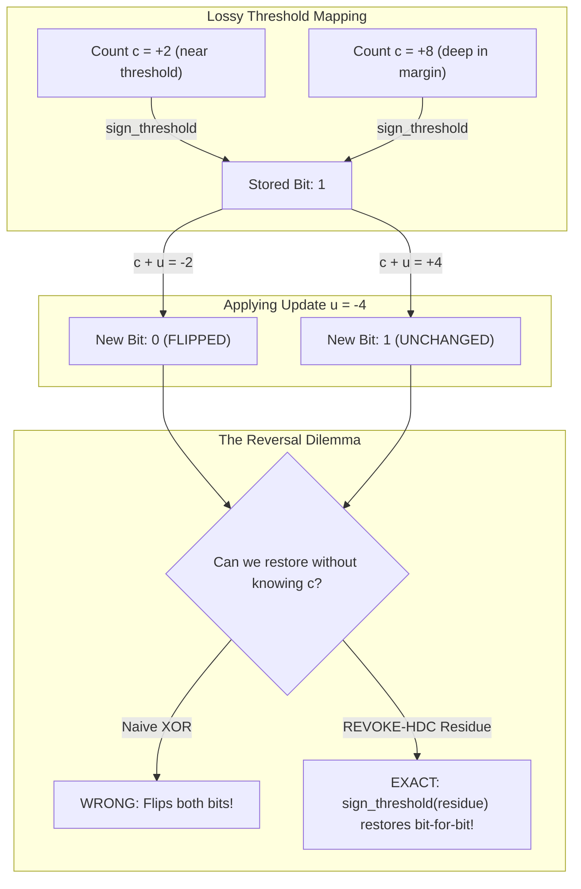
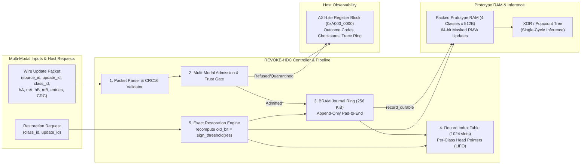
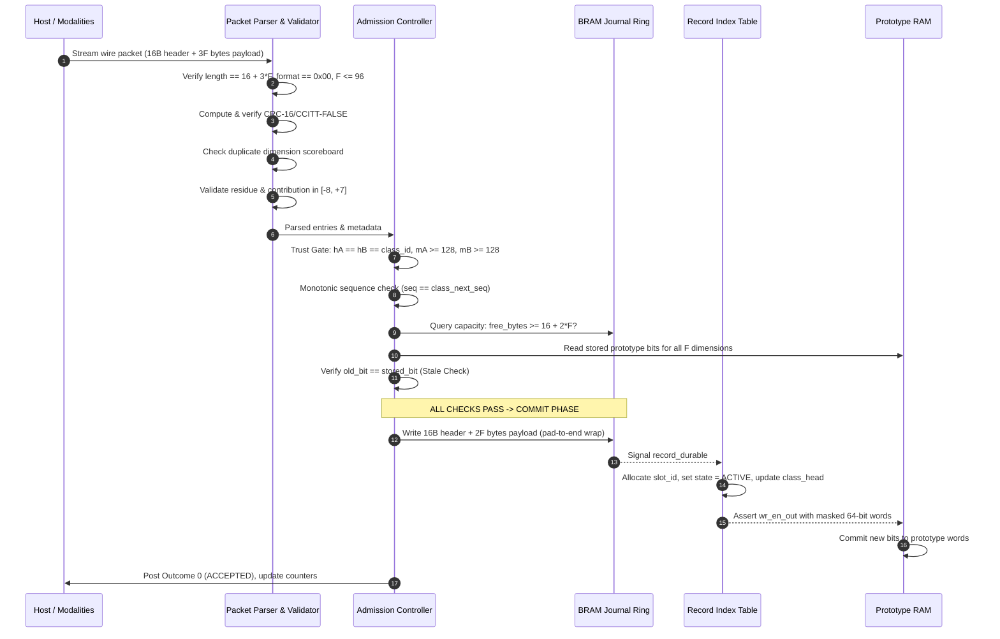
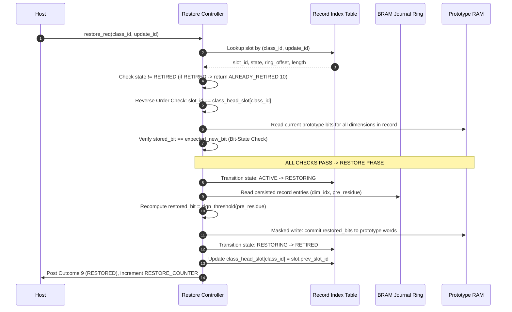

# REVOKE-HDC: Complete End-to-End Architectural Walkthrough and System Guide

**Team P3 — Live-State FPGA Studio**  
**Target Platform:** Xilinx Kria KV260 Vision AI Starter Kit (`xczu5ev-sfvc784-1-i`)  
**Core Topic:** Reversible Updates for Compact Binary HDC Prototypes via Fixed-Capacity Write-Ahead Journaling  

---

## Table of Contents
1. [Executive Summary & Motivation](#1-executive-summary--motivation)
2. [HDC Fundamentals & The Information-Loss Problem](#2-hdc-fundamentals--the-information-loss-problem)
3. [REVOKE-HDC Solution Architecture](#3-revoke-hdc-solution-architecture)
4. [Mathematical Foundations & Numerical Coupling](#4-mathematical-foundations--numerical-coupling)
5. [Memory Break-Even & Sizing Derivations](#5-memory-break-even--sizing-derivations)
6. [Life of an Update: Forward Admission & Commit](#6-life-of-an-update-forward-admission--commit)
7. [Life of a Restoration: Exact LIFO Revocation](#7-life-of-a-restoration-exact-lifo-revocation)
8. [The 11 Outcome Codes & Refusal Precedence](#8-the-11-outcome-codes--refusal-precedence)
9. [The Four Comparison Arms (A, B, C, D)](#9-the-four-comparison-arms-a-b-c-d)
10. [Hardware Mapping & KV260 Register Observability](#10-hardware-mapping--kv260-register-observability)
11. [Software Reference Model & Verification Suite](#11-software-reference-model--verification-suite)
12. [Eight-Week Roadmap & Current Milestone Status](#12-eight-week-roadmap--current-milestone-status)

---

## 1. Executive Summary & Motivation

### The Context
Hyperdimensional Computing (HDC) is a brain-inspired computing paradigm that uses long, pseudo-orthogonal vectors (here $D = 4096$ dimensions) for high-efficiency classification on edge devices. In hardware, trained class prototypes are stored as compact **word-packed binary hypervectors** ($1 \text{ bit per dimension}$), allowing query classification to run at tens of millions of inferences per second using single-cycle bitwise XOR and popcount adder trees.

### The Problem
During online learning (e.g. streaming multi-modal sensor data from vision and IMUs), class prototypes must be updated as new observations arrive. However, when an online update is later identified as faulty—such as from a glitched camera, sensor drift, or an adversarial input—**there is no simple way to undo the update**. 

Because binary quantization compresses an entire integer vote accumulator down to a single bit ($\ge 0 \implies 1, < 0 \implies 0$), the stored prototype completely forgets how close the count was to flipping. Simply applying XOR or subtracting the update hypervector is mathematically incorrect and corrupts unrelated dimensions.

### The Solution: REVOKE-HDC
REVOKE-HDC introduces a **hardware-enforced Write-Ahead Logging (WAL) and residue-restoration engine**:
- It evaluates incoming candidate updates against a multi-modal trust gate ($h_A == h_B == \text{class\_id}$, margins $\ge 128$).
- For dimensions close enough to threshold to cross it ($F \le 96$), it captures a compact **4-bit signed residue** representing the exact distance to threshold before the update.
- It writes a sparse journal record ($16 + 2F$ bytes) to an on-chip BRAM ring buffer **strictly before** prototype memory write-enables are asserted.
- When an update must be revoked, the controller unwinds the update in **reverse commit order** (LIFO per class), recomputing the exact prior bit as $\text{sign\_threshold}(residue)$ without ever having stored the full 16-bit accumulator counts!

---

## 2. HDC Fundamentals & The Information-Loss Problem

### 2.1 How HDC Classification Operates
1. **Continuous Feature Encoding**: Multi-modal sensor features (32 vision features, 16 IMU features) are projected into $D = 4096$ dimensions using continuous item memory.
2. **Bundling (Superposition)**: Constituent vectors are added together: $S = \sum_i V_i$.
3. **Class Accumulator**: Class prototypes maintain a signed count per dimension $c_d \in \mathbb{Z}$.
4. **Quantization to Compact Binary Prototype**:
   $$b_d = \text{sign\_threshold}(c_d) = \begin{cases} 1 & \text{if } c_d \ge 0 \\ 0 & \text{if } c_d < 0 \end{cases}$$
5. **Inference**: A query hypervector $Q \in \{0, 1\}^{4096}$ is classified against prototype $P_c$ using Hamming distance:
   $$\text{Hamming}(Q, P_c) = \text{popcount}(Q \oplus P_c)$$
   The class with the smallest Hamming distance wins.

### 2.2 Why Thresholding Destroys Reversibility
Thresholding is a **non-injective function** ($\mathbb{Z} \to \{0, 1\}$). All integers in $[0, +\infty)$ collapse to bit `1`, and all integers in $(-\infty, -1]$ collapse to bit `0`.

Consider two different dimensions with hidden counts $c_1 = +2$ and $c_2 = +8$:
- Both counts produce stored bit `1`.
- Now apply an online update contribution $u = -4$:
  - Dimension 1: $c_1' = +2 + (-4) = -2 < 0 \implies \mathbf{0}$ (**Bit flips $1 \to 0$!**)
  - Dimension 2: $c_2' = +8 + (-4) = +4 \ge 0 \implies \mathbf{1}$ (**Bit stays $1$!**)

If an external controller later commands: *"Undo update $u = -4$"*, look at what happens:
- If we do naive XOR: both Dimension 1 and Dimension 2 would toggle, corrupting Dimension 2!
- If we do naive subtraction: we don't know what count was behind the bit!



---

## 3. REVOKE-HDC Solution Architecture

REVOKE-HDC solves this problem by pairing the 64-bit packed prototype memory with an append-only BRAM journal and an exact restoration engine.



### The 7 Hardware Modules (`PROJECT_PLAN.md` Section 3.1)
1. **Packet Parser / Validator**: Frames incoming stream bytes, evaluates CRC-16/CCITT-FALSE, checks for duplicate dimension indices via a scoreboard, and verifies alphabet bounds.
2. **Admission Controller**: Checks multi-modal agreement ($h_A == h_B == \text{class\_id}$), margin thresholds ($m_A \ge \theta_A, m_B \ge \theta_B$), sequence monotonicity, and journal capacity ($J_{\text{req}} \le J_{\text{free}}$).
3. **Prototype Memory**: 4 classes $\times$ 64 words $\times$ 64 bits ($D = 4096$). Implements 64-bit masked read-modify-write so multiple entries in the same word commit in one cycle.
4. **Journal Memory**: 256 KiB append-only BRAM ring buffer. Implements the pad-to-end wrap policy.
5. **Record Index Table**: 1024 slots storing metadata, state (`FREE`, `ACTIVE`, `RESTORING`, `RETIRED`), and class-chain linked list pointers.
6. **Commit / Restore Controller**: The single master FSM governing the admission-to-commit and lookup-to-restore lifecycles. It is the only entity permitted to drive prototype write-enables.
7. **Outcome / Status Register Block**: Memory-mapped AXI-Lite slave exposing status registers, counters, prototype CRC-32 checksums, and the trace FIFO.

---

## 4. Mathematical Foundations & Numerical Coupling

### 4.1 Why Residue Width is Not a Free Choice
A dimension changes its stored bit only when its accumulator count is already close to threshold 0:
- If current count $c \ge 0$ (bit 1) and update $u$ flips it to $c + u < 0$ (bit 0), then:
  $$0 \le c < |u|$$
- If current count $c < 0$ (bit 0) and update $u$ flips it to $c + u \ge 0$ (bit 1), then:
  $$-|u| \le c < 0$$

Therefore, every affected dimension strictly satisfies $|c| < |u|_{\max}$. The residue field must represent that exact interval:
$$\text{residue\_bits} \ge \lceil\log_2(2 \cdot |u|_{\max})\rceil$$

### 4.2 The 4-Bit Signed Alphabet & The $+8$ Two's-Complement Constraint
In REVOKE-HDC:
- Residue width is frozen at **4 bits signed two's-complement**: representable range $[-8, +7]$.
- Update contribution alphabet: $4 \text{ bits signed}$.
- While the specification phrase states $|u| \le 8$, in two's complement arithmetic, 4 bits represent $-8$ (`0b1000`) up to $+7$ (`0b0111`).
- Conceptual $+8$ requires 5 bits (`0b01000`). Truncating $+8$ to 4 bits produces `0b1000` (which is $-8$), causing catastrophic bit inversion!
- **Engineering Decision (Closed in Week 1)**: Conceptual $+8$ is refused at admission with `refused_residue` (Outcome 4). The encodable valid alphabet is $[-8, +7]$.

### 4.3 Deterministic Re-Prediction Equations
For every entry in a candidate update packet:
$$\text{old\_bit} = \text{sign\_threshold}(pre\_update\_residue)$$
$$\text{new\_bit} = \text{sign\_threshold}(pre\_update\_residue + update\_contribution)$$
where $\text{sign\_threshold}(x) = 1 \text{ if } x \ge 0 \text{ else } 0$.

Admission requires that for every entry:
$$\text{old\_bit} == \text{current\_stored\_prototype\_bit}$$
If any bit disagrees, the packet was formed against stale state and is refused with `refused_stale` (Outcome 5).

---

## 5. Memory Break-Even & Sizing Derivations

### 5.1 Formulations
- **Wire Packet**:
  $$L_{\text{wire}}(F) = 16 + 3F \text{ bytes}$$
  (16-byte header including 2-byte CRC-16 + $F$ 24-bit wire entries).
- **Persisted Journal Record**:
  $$R(F) = 16 + 2F \text{ bytes}$$
  (16-byte header + $F$ 16-bit entries: 12-bit dimension + 4-bit signed residue).
- **Full Prototype Snapshot (Arm C Baseline)**:
  $$S_{\text{snapshot}} = 512 \text{ bytes}$$
  (4096 dimensions $\times$ 1 bit = 512 bytes per class).

### 5.2 Break-Even Proof
Sparse journaling uses strictly less BRAM than full snapshots if and only if:
$$16 + 2F < 512 \iff 2F < 496 \iff \mathbf{F < 248}$$

Because the frozen cohort maximum is $F_{\max} = 96$:
$$R(96) = 16 + 2 \times 96 = \mathbf{208 \text{ bytes}}$$
$$208 \text{ bytes} \ll 512 \text{ bytes} \quad (\mathbf{59.4\% \text{ memory savings at worst-case } F!})$$

For typical updates ($F \approx 40$):
$$R(40) = 16 + 2 \times 40 = \mathbf{96 \text{ bytes}} \quad (\mathbf{81.3\% \text{ memory savings!}})$$

```text
Memory (Bytes)
512 B |-------------------------------------------------[Arm C Snapshot Baseline: 512 B]-----
      |                                                /
208 B |------------------[Max F = 96: 208 B]          /
      |                 /                            /
 96 B |---[F = 40: 96B]/                            /
      |  /                                         /
 16 B |-/                                         /
    0 +------------------------------------------+------------------------------------> F
      0                 40              96      247   248 (Break-Even Point)
      |<--- REVOKE-HDC Operating Regime ------>|
```

---

## 6. Life of an Update: Forward Admission & Commit

Every candidate update packet follows an atomic, hardware-enforced write-ahead pipeline:



### The 64-Bit Write-Mask Combining Rule
If a packet contains multiple entries targeting dimensions in the same 64-bit word (e.g. dimension 65 and dimension 120, both in Word 1):
$$\text{word\_idx} = d \gg 6, \quad \text{bit\_idx} = d \ \& \ 63$$
The controller groups them, constructs a 64-bit write mask (`(1 << 1) | (1 << 56)`), and updates Word 1 in **exactly one read-modify-write clock cycle**, eliminating multi-cycle RAM hazards.

---

## 7. Life of a Restoration: Exact LIFO Revocation

When an update is revoked (due to sensor fault, drift, or bad data), the host issues a restoration request with `(class_id, update_id)`:



### Why Reverse Commit Order (LIFO) is Mandatory
If Update 1 changes dimension $d$, and Update 2 later changes the same dimension $d$, attempting to restore Update 1 while Update 2 is still active would overwrite the newer bit state! By enforcing LIFO per class, every dimension is guaranteed to be restored in the exact reverse sequence of its modification, guaranteeing $100\%$ bit-identical recovery.

---

## 8. The 11 Outcome Codes & Refusal Precedence

Every request produces exactly one outcome code ($0..10$) and updates `LAST_OUTCOME_CODE`:

| Code | Outcome Name | Prototype Mutated? | Journal Mutated? | Exact Trigger Condition |
|:---:|---|:---:|:---:|---|
| **0** | `accepted` | **Yes** | **Yes** | All structural, CRC, alphabet, margin, sequence, capacity, and stored-bit checks pass. Durable record written before prototype write. |
| **1** | `quarantined` | **No** | **No** | Packet structurally valid, but $h_A \ne h_B$, or $m_A < \theta_A$, or $m_B < \theta_B$. Candidate update isolated. |
| **2** | `refused_capacity` | **No** | **No** | Required bytes $16 + 2F > J_{\text{free}}$, or Record Index Table has no free slots ($N=1024$). |
| **3** | `refused_checksum` | **No** | **No** | Recomputed CRC-16/CCITT-FALSE does not equal header `checksum`. |
| **4** | `refused_residue` | **No** | **No** | Signed residue outside $[-8, +7]$, or contribution outside $[-8, +7]$ (including conceptual $+8$). |
| **5** | `refused_stale` | **No** | **No** | At admission: $\text{sign\_threshold}(pre\_residue) \ne \text{stored prototype bit}$. |
| **6** | `refused_duplicate` | **No** | **No** | Dimension index repeats within the same candidate packet. |
| **7** | `refused_ordering` | **No** | **No** | At admission: sequence out of order. At restoration: target record is not the current active class head. |
| **8** | `refused_bit_state` | **No** | **No** | At admission: expected bit claim mismatch or reserved bits $\ne 0$. At restore: stored bit $\ne$ expected post-update bit. |
| **9** | `restored` | **Yes** *(reverted)* | **Yes** *(retired)* | Active class-head record unwound: bits recomputed from residues, written to RAM, slot retired. |
| **10** | `already_retired` | **No** | **No** | Restoration request targets a slot already in `RETIRED` state. Prevents double-flipping. |

### Invariant 7: Absolute Immutability on Refusal
For codes 1 through 8 and 10:
$$\Delta(\text{Prototype RAM}) = 0 \quad \text{and} \quad \Delta(\text{Journal Free Bytes}) = 0$$
Zero prototype bits are modified, and zero journal bytes are consumed.

---

## 9. The Four Comparison Arms (A, B, C, D)

To isolate the exact contribution of the sparse residue journal, REVOKE-HDC benchmarks four comparison arms under identical workloads, clocks, and seeds:

| Arm | Architecture | Storage Cost per Update | Behavior on Bad Update & Restoration | Role in Evaluation Campaign |
|:---:|---|:---:|---|---|
| **A** | Full Signed Accumulators | Fixed $4096 \times 16\text{b} = 8192\text{ B/class}$ | Adds and subtracts full numeric counts directly. Bit-exact by construction. | Accuracy & exactness reference; not memory-competitive for edge FPGA. |
| **B** | Packed Binary Only | Fixed $0\text{ bytes}$ (no log) | In-place XOR update. **Cannot reverse updates**. Bad updates cause permanent accuracy degradation. | Unprotected baseline; demonstrates the necessity of the project. |
| **C** | Full Prototype Snapshots | Fixed $512\text{ bytes/update}$ | Saves full 512-byte prototype image per accepted update. Restores via full copy-back. | Brute-force snapshot baseline; memory-heavy ($512\text{ B}$ vs $96\text{ B}$). |
| **D** *(Proposed)* | Packed RAM + Sparse Journal | Variable $16 + 2F\text{ bytes/update}$ ($97.2\text{ B}$ mean) | WAL BRAM ring + reverse-commit restoration from 4-bit residues. Bit-identical recovery. | Proposed compact exact core; saves $59.4\%$ to $96.9\%$ memory vs Arm C. |

---

## 10. Hardware Mapping & KV260 Register Observability

The REVOKE-HDC core integrates as an AXI4-Lite slave on the Xilinx Kria KV260 PS-PL interconnect:
- **Base Address**: `0xA000_0000`
- **Address Range**: `0xA000_0000` – `0xA000_FFFF` (64 KiB)
- **Bus Interface**: PS `M_AXI_HPM0_FPD` $\to$ AXI SmartConnect $\to$ PL REVOKE-HDC

### Register Map (`PROJECT_PLAN.md` Section 4.6)

| Offset | Register Name | Access | Width | Description |
|:---:|---|:---:|:---:|---|
| `0x00` | `CTRL` | RW | 32b | Bit 0: `enable`; Bit 1: `soft_reset`; Bits $[3:2]$: `class_select` ($0..3$). |
| `0x04` | `STATUS` | RO | 32b | Bit 0: `busy`; Bit 1: `last_outcome_valid`. |
| `0x08` | `LAST_OUTCOME_CODE` | RO | 32b | Outcome code $0..10$ of most recently processed request. |
| `0x0C` | `LAST_UPDATE_ID` | RO | 32b | Identifier of most recently processed request. |
| `0x10` | `JOURNAL_FREE_BYTES` | RO | 32b | Current unallocated bytes in BRAM ring buffer. |
| `0x14` | `JOURNAL_HEAD_OFFSET` | RO | 32b | Current byte write offset in ring buffer. |
| `0x18` | `JOURNAL_TAIL_OFFSET` | RO | 32b | Oldest un-retired byte offset in ring buffer. |
| `0x1C` | `CLASS_HEAD_SLOT` | RO | 32b | Active head slot ID for class selected in `CTRL.class_select`. |
| `0x20` | `UPDATE_COUNTER` | RO | 32b | Total accepted updates committed. |
| `0x24` | `RESTORE_COUNTER` | RO | 32b | Total successful restorations completed. |
| `0x28` | `REFUSED_COUNTER` | RO | 32b | Total refused or quarantined requests. |
| `0x2C` | `PROTOTYPE_CHECKSUM` | RO | 32b | CRC-32 of 512-byte prototype memory for `CTRL.class_select`. |
| `0x30` | `TRACE_POP` | RO | 32b | Pops one 8-byte trace entry (requires two 32-bit reads). |
| `0x34` | `TRACE_COUNT` | RO | 32b | Number of trace records currently buffered. |

*Zero logic analyzer probes are required*: all state transitions, checksums, and outcome codes are directly observable over AXI-Lite from the Linux user terminal on the KV260.

---

## 11. Software Reference Model & Verification Suite

The software reference model implemented in `sim/` and tested in `tests/` serves as the exact golden specification for the Week 3 RTL:

### 11.1 Key Modules
- [`sim/crc16.py`](file:///Users/satvik/Downloads/HSC_Lab-P3-main/P3_REVOKE_HDC/sim/crc16.py): Bit-true CRC-16/CCITT-FALSE engine.
- [`sim/hdc_core.py`](file:///Users/satvik/Downloads/HSC_Lab-P3-main/P3_REVOKE_HDC/sim/hdc_core.py): 4096-bit prototype memory with 64-bit masked RMW, CRC-32 generator, and multi-modal feature encoder.
- [`sim/packet.py`](file:///Users/satvik/Downloads/HSC_Lab-P3-main/P3_REVOKE_HDC/sim/packet.py): 24-bit wire entry packing, 16-byte header framing, and CRC verification.
- [`sim/journal.py`](file:///Users/satvik/Downloads/HSC_Lab-P3-main/P3_REVOKE_HDC/sim/journal.py): 256 KiB ring buffer with pad-to-end allocation and 1024-slot Record Index Table.
- [`sim/engine.py`](file:///Users/satvik/Downloads/HSC_Lab-P3-main/P3_REVOKE_HDC/sim/engine.py): Master controller coordinating admission, commit, and LIFO restoration.

### 11.2 Verification Results
1. **Week 2 Smallest Test** ([`tests/test_smallest_w2.py`](file:///Users/satvik/Downloads/HSC_Lab-P3-main/P3_REVOKE_HDC/tests/test_smallest_w2.py)):
   - Hand-built 2-entry packet (dim 100, dim 200). Updated, then restored.
   - **Result**: Word-for-word identical match with baseline clone (**0 mismatches**).
2. **Negative Test Suite** ([`tests/test_negative_cases.py`](file:///Users/satvik/Downloads/HSC_Lab-P3-main/P3_REVOKE_HDC/tests/test_negative_cases.py)):
   - Tested all 10 refusal and quarantine cases.
   - **Result**: All 10 cases returned exact expected outcome codes, and prototype RAM and journal `free_bytes` remained 100% untouched.
3. **1,000-Update Exact Restoration Regression** ([`tests/test_exact_restoration.py`](file:///Users/satvik/Downloads/HSC_Lab-P3-main/P3_REVOKE_HDC/tests/test_exact_restoration.py)):
   - 1,000 continuous updates committed and restored across all 4 classes.
   - **Total Bit Mismatches**: **0 (Target: 0)** across all 4,096,000 checked bit positions!
   - Measured flip distribution: Mean $F = 40.62$, Median $F = 40$, $p95 = 65$, Max $F = 91$.
   - Mean record size: $97.23 \text{ bytes}$ (**81.0% savings** vs 512B snapshot).
   - Break-even frequency ($F < 248$): **100.0%**.

---

## 12. Eight-Week Roadmap & Current Milestone Status

| Week | Milestone / Goal | Deliverable Focus | Status |
|:---:|---|---|:---:|
| **W0** | HDC Foundations & Information Loss | Reading synthesis, hand Hamming calculation, threshold-loss count pairs, tiny packet. | **COMPLETED (GREEN)** |
| **W1** | Contract Freeze & Format Specifications | Bit-field layouts, sizing sheet, refusal table, 16 closed decisions, 42 hand vectors. | **COMPLETED (GREEN)** |
| **W2** | Software Reference & Exact Core Restoration | Bit-true simulator, negative suite, 1,000-update regression (0 mismatches), figures. | **COMPLETED (GREEN)** |
| **W3** | Packed Prototype & Journal Memories | RTL BRAM RAMs, XOR/popcount path, write-mask grouping, Invariant 1 assertions. | *Upcoming* |
| **W4** | Admission & Restoration Engine Integration | RTL FSM, reverse-commit head checks, AXI-Lite registers, multi-class arbitration. | *Upcoming* |
| **W5** | Board Integration on KV260 | Hardware bring-up, injected bad updates, observable register validation, 0 mismatches. | *Upcoming* |
| **W6** | Four-Arm Memory & Recovery Campaign | Full campaign comparing Arms A, B, C, D across swept flip counts and journal sizes. | *Upcoming* |
| **W7** | Endurance, Ordering & Corruption Stress | Ring wrap stress, reset during write, stall stress, fault injection matrix. | *Upcoming* |
| **W8** | Final Freeze, Independent Reproduction & Handover | One-command handover, clean independent student reproduction without verbal help. | *Upcoming* |

---

## 13. Summary of Master Execution Commands

```bash
# Run entire end-to-end verified pipeline:
bash P3_REVOKE_HDC/scripts/run_all.sh

# Or run individual weekly stages:
bash P3_REVOKE_HDC/scripts/run_week0.sh          # Week 0 Foundations
bash P3_REVOKE_HDC/scripts/run_week1.sh          # Week 1 Contract Verification
python3 P3_REVOKE_HDC/tests/test_smallest_w2.py # Week 2 Smallest Test
python3 P3_REVOKE_HDC/tests/test_negative_cases.py # Week 2 Negative Suite
python3 P3_REVOKE_HDC/tests/test_exact_restoration.py # Week 2 1000-Update Regression
python3 P3_REVOKE_HDC/scripts/generate_figures.py # Generate Figures 2 & 3
```
