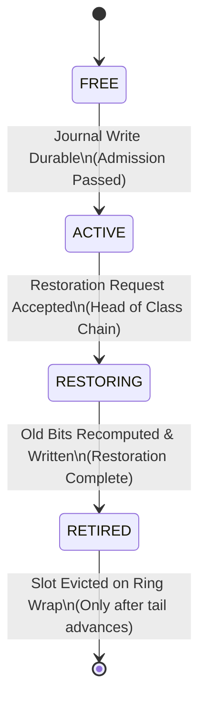
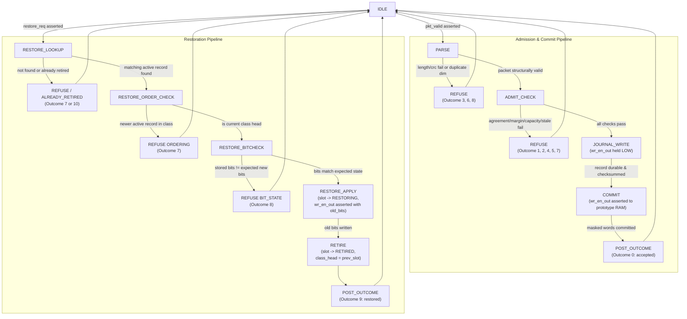

# Ordering State and Controller Lifecycle - REVOKE-HDC (Week 1 Frozen)

## 1. Record Lifecycle State Machine

Each allocated slot in the Record Index Table follows a strictly non-cyclical, monotonic four-state lifecycle:

### Invariant State Transition Rules
1. **Strict Monotonicity**: A slot moves strictly `FREE -> ACTIVE -> RESTORING -> RETIRED`.
2. **No Re-activation**: A record in state `RETIRED` or `RESTORING` can NEVER transition back to `ACTIVE`.
3. **No Skipping**: A record can never transition directly from `ACTIVE` to `RETIRED` without passing through `RESTORING`.
4. **Idempotent Restoration Protection**:
   - If a restoration request arrives for an `update_id` whose slot is already `RETIRED`, the controller returns Outcome 10 (`already_retired`).
   - The write-enable `wr_en_out` is held deasserted, and zero prototype bits are flipped.

---

## 2. Controller State Machine (from `PROJECT_PLAN.md` Section 3.3)

The REVOKE-HDC controller contains a single centralized state machine that enforces record durability before prototype commit, and reverse-order verification before prototype restoration:

---

## 3. Transition Conditions Table

| State | Next State | Condition | Notes |
|---|---|---|---|
| `IDLE` | `PARSE` | `pkt_valid == 1` | Latches incoming packet bytes. |
| `PARSE` | `ADMIT_CHECK` | Packet framed, length/CRC pass, duplicate scoreboard clean | Moves to multi-modal and memory admission. |
| `PARSE` | `REFUSE` | Checksum mismatch (`3`), length error (`8`), duplicate dimension (`6`) | No prototype or journal mutation. |
| `ADMIT_CHECK` | `JOURNAL_WRITE` | $h_A == h_B == \text{class\_id}$, margins pass, $J_{\text{req}} \le J_{\text{free}}$, sequence monotonic, all old bits match prototype | All prerequisites met. |
| `ADMIT_CHECK` | `REFUSE` | Margin fail (`1`), full ring (`2`), alphabet exceed (`4`), stale old-bit (`5`), out-of-order sequence (`7`) | Returns exact failure code. |
| `JOURNAL_WRITE` | `COMMIT` | Record appended to ring, checksum valid, index slot marked `ACTIVE` | `wr_en_out` physically held low until durability acknowledged. |
| `COMMIT` | `IDLE` | Masked updates written to prototype RAM | Emits Outcome 0 (`accepted`). |
| `IDLE` | `RESTORE_LOOKUP` | `restore_req == 1` | Look up slot by `(class_id, update_id)`. |
| `RESTORE_LOOKUP` | `RESTORE_ORDER_CHECK` | Matching slot found and state is `ACTIVE` | Proceed to reverse-order validation. |
| `RESTORE_LOOKUP` | `REFUSE` | Slot not found (`7`), or state is `RETIRED` (`10: already_retired`) | Refuses safely. |
| `RESTORE_ORDER_CHECK` | `RESTORE_BITCHECK` | `slot_id == class_head_slot[class_id]` | Confirmed as latest update in class. |
| `RESTORE_ORDER_CHECK` | `REFUSE` | `slot_id != class_head_slot[class_id]` | Emits `refused_ordering` (`7`). |
| `RESTORE_BITCHECK` | `RESTORE_APPLY` | All listed dimensions match expected post-update bits | Transitions slot state to `RESTORING`. |
| `RESTORE_BITCHECK` | `REFUSE` | Any listed dimension differs from expected post-update bit | Emits `refused_bit_state` (`8`). |
| `RESTORE_APPLY` | `RETIRE` | All old bits computed as $\text{sign}(residue)$ written back to RAM | Masked write to prototype RAM. |
| `RETIRE` | `IDLE` | Slot marked `RETIRED`, head pointer updated | Emits Outcome 9 (`restored`). |
