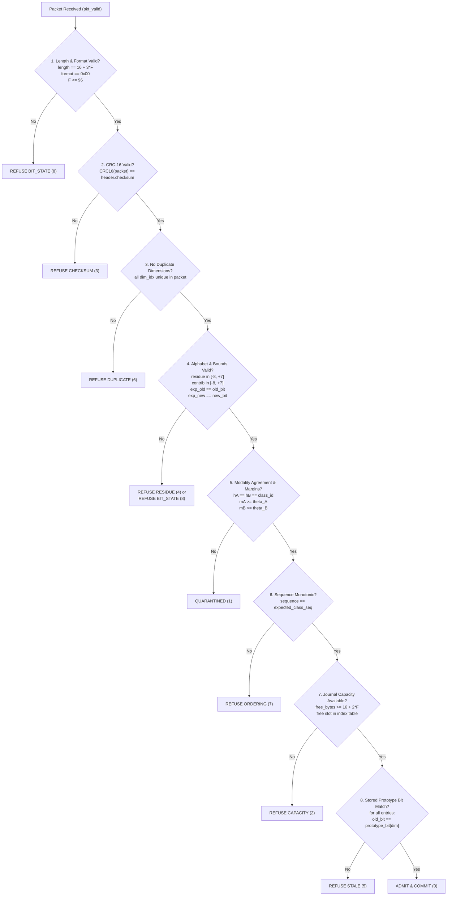

# Packet Validation, Admission and Restoration Rules - REVOKE-HDC (Week 1 Frozen)

## 1. Mathematical Foundations & Bit-Prediction Equations

For each affected dimension entry in an incoming candidate transition packet, the controller evaluates two deterministic bit-prediction equations:

### Equation 1: Reconstructed Pre-Update Stored Bit
$$\text{old\_bit} = \text{sign\_threshold}(\text{pre\_update\_residue})$$
where:
$$\text{sign\_threshold}(x) = \begin{cases} 1 & \text{if } x \ge 0 \\ 0 & \text{if } x < 0 \end{cases}$$

### Equation 2: Reconstructed Post-Update Stored Bit
$$\text{new\_bit} = \text{sign\_threshold}(\text{pre\_update\_residue} + \text{update\_contribution})$$

### Signed Representation & Bounds
- `pre_update_residue` is signed 4-bit two's-complement: range $[-8, +7]$.
- `update_contribution` is signed 4-bit two's-complement: range $[-8, +7]$.
- While the high-level specification allows $|u| \le 8$, in two's complement arithmetic 4 bits can represent $-8$ but cannot represent $+8$ without overflow into the sign bit. Therefore:
  - Contributions in $[-8, +7]$ are encodable and valid.
  - Any conceptual contribution of $+8$ cannot be encoded in 4 bits and is refused at packet formation with `refused_residue` (Outcome 4).

---

## 2. Deterministic Validation Precedence at Admission

When a wire packet arrives, the controller evaluates checks in a deterministic order. If multiple defects exist, the earliest check in the pipeline determines the outcome code:

---

## 3. Admission Decision Formula

An update is admitted to the live system if and only if all eight conditions pass simultaneously:

$$\text{admit} = (\text{format\_ok}) \land (\text{crc\_ok}) \land (\neg\text{duplicate\_dim}) \land (\text{alphabet\_ok}) \land (h_A == h_B == \text{class\_id}) \land (m_A \ge \theta_A) \land (m_B \ge \theta_B) \land (\text{seq\_monotonic}) \land (J_{\text{req}} \le J_{\text{free}}) \land (\text{old\_bits\_match})$$

- $\theta_A = 128$: Modality-A confidence margin threshold.
- $\theta_B = 128$: Modality-B confidence margin threshold.
- $J_{\text{req}} = 16 + 2F$: Persisted record size required in BRAM ring buffer.
- $J_{\text{free}}$: Remaining unallocated, non-live contiguous bytes in BRAM ring.

---

## 4. Prototype Commit & Atomicity Rule

1. **Write-Ahead Discipline (Record-before-Commit)**:
   - The sparse journal record ($16 + 2F$ bytes) must be fully written to the BRAM ring buffer and marked `ACTIVE` in the Record Index Table strictly before any prototype write occurs.
   - The hardware assertion enforces:
     $$\text{wr\_en\_out} \implies (\text{state} == \text{COMMIT} \lor \text{state} == \text{RESTORE\_APPLY})$$
2. **64-Bit Word Mask Combining**:
   - Multiple entries within the same packet may target different bit positions within the same 64-bit prototype word.
   - Entries targeting the same word are combined using a 64-bit mask:
     $$\text{mask} = \sum_{i \in \text{entries for word } W} (1 \ll (\text{dim}_i \ \& \ 63))$$
     $$\text{new\_data} = (\text{old\_data} \ \& \ \neg\text{mask}) \ | \ \sum_{i \in \text{entries for word } W} (\text{new\_bit}_i \ll (\text{dim}_i \ \& \ 63))$$
   - Each touched 64-bit word is updated in exactly one masked read-modify-write cycle.
3. **Outcome Logging**:
   - Once all touched prototype words are committed, the controller emits Outcome 0 (`accepted`) and increments `UPDATE_COUNTER`.

---

## 5. Reverse-Order Restoration Rules

When a restoration request is received with $(\text{class\_id}, \text{update\_id})$:

1. **Lookup & Identity Check**:
   - The controller queries the Record Index Table for a slot matching `class_id` and `update_id`.
   - If no matching slot exists: emit `refused_ordering` (Outcome 7).
2. **Lifecycle State Check**:
   - If slot state is `RETIRED`: emit `already_retired` (Outcome 10). Neither prototype nor journal state changes.
   - If slot state is not `ACTIVE`: emit `refused_ordering` (Outcome 7).
3. **Reverse Commit Order Check**:
   - The requested slot must equal `class_head_slot[class_id]`.
   - If a newer `ACTIVE` record exists in the class chain: emit `refused_ordering` (Outcome 7). Restoration through an intervening update is strictly forbidden.
4. **Current Prototype Bit Check**:
   - For every entry in the record, read the current stored bit from prototype memory.
   - The stored bit MUST equal the record's expected post-update bit ($\text{new\_bit}$).
   - If any bit does not match: emit `refused_bit_state` (Outcome 8).
5. **Exact Bit Reconstruction & Application**:
   - Transition slot state: `ACTIVE -> RESTORING`.
   - For each dimension $d$ in the record, recompute the prior bit directly from the retained residue:
     $$\text{restored\_bit} = \text{sign\_threshold}(\text{pre\_update\_residue})$$
   - Combine updates per 64-bit word using write masks.
   - Apply masked write to prototype RAM.
6. **Retirement**:
   - Transition slot state: `RESTORING -> RETIRED`.
   - Update class head pointer: $\text{class\_head\_slot}[\text{class\_id}] = \text{slot.prev\_slot\_id}$.
   - Post Outcome 9 (`restored`) and increment `RESTORE_COUNTER`.
