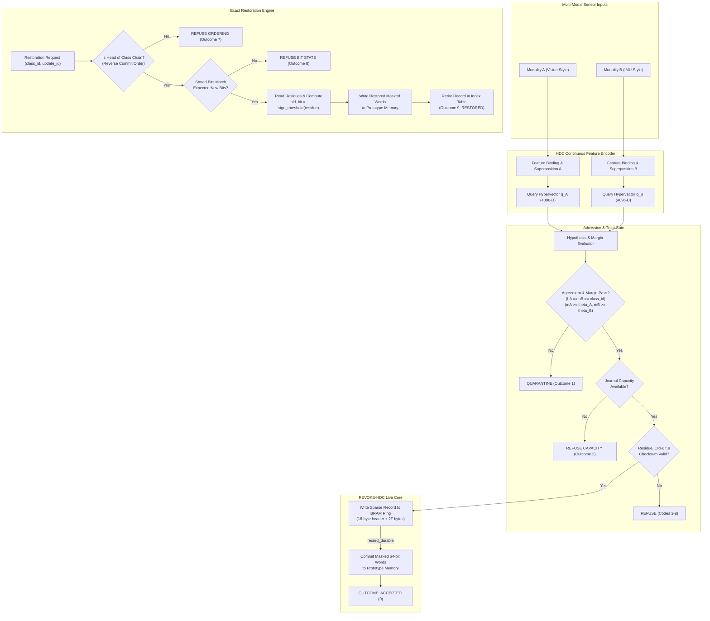

# P3 REVOKE-HDC: Week 0 Reading Notes and Mathematical Foundations

## 1. Executive Summary & Week 0 Goal

- **Goal**: Establish the fundamental mathematics of Hyperdimensional Computing (HDC), prove the information loss caused by majority/sign thresholding, calculate hand Hamming distances, demonstrate manual 2-dimension packet update and restoration, freeze the core restoration order in one sentence, and specify the software HDC encoder and four comparison arms.
- **Assigned Team**: Team P3 (REVOKE-HDC)
- **Primary Target Device**: Xilinx Kria KV260 Vision AI Starter Kit (`kv260`)

---

## 2. Reading Notes on Assigned Week 0 Papers

### Paper 1: *A Survey on Hyperdimensional Computing, Part I: Models and Data Transformations*
*(Kanerva, Rahimi, Karunaratne et al., arXiv:2111.06077)*

- **Core Concept**: Hyperdimensional Computing operates on high-dimensional vectors ($D \ge 1000$, here $D = 4096$) with random, pseudo-orthogonal representations.
- **Primary Operations**:
  1. **Bundling (Superposition / Addition)**:
     - Vector addition $S = \sum_i V_i$.
     - *Preserves*: Component similarity; the bundled hypervector remains similar to each of its constituent vectors.
     - *Discards*: Individual constituent isolation; once bundled and binarized, individual components cannot be unbound without storing additional context or using orthogonal projections.
  2. **Binding (Multiplication / XOR)**:
     - Associative, invertible operation $B = V_1 \oplus V_2$.
     - *Preserves*: Orthogonality; $B$ is quasi-orthogonal to both $V_1$ and $V_2$.
     - *Discards*: Similarity to inputs; binds variable-value pairs (e.g., feature ID bound to feature level).
  3. **Permutation (Cyclic Shift)**:
     - Shift operation $\rho^k(V)$ that produces an orthogonal vector for sequence and temporal encoding.
     - *Preserves*: Distance metric under identical shifts; invertible by $\rho^{-k}$.
  4. **Similarity Metric**:
     - Binary HDC uses the Hamming Distance:
       $$\text{Hamming}(q, p) = \text{popcount}(q \oplus p)$$
     - Normalized distance: $d_H(q, p) = \frac{\text{popcount}(q \oplus p)}{D}$.
     - Orthogonal vectors have expected Hamming distance $D/2 = 2048$ bits.

### Paper 2: *OnlineHD: Robust, Efficient, and Single-Pass Online Learning Using Hyperdimensional System*
*(Hernandez-Cano et al., DATE 2021)*

- **Core Concept**: Adaptively updates class prototypes during continuous stream classification using single-pass online learning.
- **Update Mechanism**:
  - When an incoming query sample $S$ with true label $y$ is misclassified as $\hat{y}$, OnlineHD updates the prototype accumulators:
    $$C_y \leftarrow C_y + \alpha \cdot S$$
    $$C_{\hat{y}} \leftarrow C_{\hat{y}} - \alpha \cdot S$$
  - Here $\alpha$ is a dynamic learning rate proportional to query similarity to the wrong class.
- **The Critical Vulnerability**:
  - In hardware inference, signed counts $C_y$ are compressed to compact binary vectors $b \in \{0, 1\}^D$ for single-cycle XOR/popcount.
  - If sample $S$ was corrupt, noisy, adversarial, or out-of-order, the update cannot simply be reversed by subtracting $\alpha \cdot S$ from the packed binary prototype $b$. Binarization destroyed the distance of $C_y$ from threshold 0!

### Paper 3: *QuantHD: A Quantization Framework for Hyperdimensional Computing*
*(Imani et al., NSF/IEEE)*

- **Core Concept**: Analyzes the compression of high-precision floating/signed-integer hypervectors down to 1-bit binary ($\{0, 1\}$ or $\{-1, +1\}$) and 2-bit ternary ($\{-1, 0, +1\}$) representations.
- **Information Loss Characterization**:
  - Binary quantization applies a sign threshold:
    $$b_d = \text{sign\_threshold}(c_d) = \begin{cases} 1 & \text{if } c_d \ge 0 \\ 0 & \text{if } c_d < 0 \end{cases}$$
  - QuantHD observes that while binary quantization reduces memory footprint by $32\times$ and replaces multiply-accumulate with XOR/popcount trees, the mapping $\mathbb{Z} \to \{0, 1\}$ is non-injective. All magnitude information $|c_d|$ is discarded.
  - An exact update reversal cannot be reconstructed without capturing the pre-threshold distance (residue) for dimensions near the threshold.

---

## 3. The Central Question: Why Can Two Different Signed Counts Produce the Same Stored Bit?

### Mathematical Explanation

The binarization function $f(c) = \mathbb{I}(c \ge 0)$ partitions the set of all integers $\mathbb{Z}$ into two infinite equivalence classes:
1. $S_1 = [0, +\infty) \cap \mathbb{Z} \implies \text{stored bit } 1$
2. $S_0 = (-\infty, -1] \cap \mathbb{Z} \implies \text{stored bit } 0$

Because $f$ is non-injective, knowing that $b_d = 1$ tells us only that $c_d \ge 0$, but gives zero information about whether $c_d = +1$ (a single-vote margin) or $c_d = +1000$ (a deeply entrenched class consensus).

When an online update contribution $u \in \mathbb{Z}$ is added ($c' = c + u$):
- If $c \in S_1$ and $c + u < 0$, the stored bit transitions $1 \to 0$. This occurs if and only if $0 \le c < |u|$ (for $u < 0$).
- If $c \in S_1$ and $c + u \ge 0$, the stored bit remains $1$. This occurs whenever $c \ge |u|$ (for $u < 0$).

Therefore, knowing the current bit $b_d$ and the update $u_d$ is mathematically insufficient to determine the new bit $b'_d$, or to reverse an update once applied.

### Three Concrete Count Pairs

Here are three distinct pairs of hidden signed counts where both counts produce the exact same stored bit, but react completely differently to the exact same update $u$:

| Pair # | Count 1 ($c_1$) | Count 2 ($c_2$) | Shared Initial Bit | Applied Update ($u$) | Result 1 ($c_1 + u$) | Result 1 Bit | Result 2 ($c_2 + u$) | Result 2 Bit | Behavior Difference |
|:---:|:---:|:---:|:---:|:---:|:---:|:---:|:---:|:---:|:---|
| **1** | $+2$ | $+8$ | **1** | $-4$ | $-2$ | **0** | $+4$ | **1** | $c_1$ crossed threshold ($1 \to 0$), $c_2$ stayed above threshold ($1 \to 1$). |
| **2** | $-1$ | $-15$ | **0** | $+5$ | $+4$ | **1** | $-10$ | **0** | $c_1$ crossed threshold ($0 \to 1$), $c_2$ stayed below threshold ($0 \to 0$). |
| **3** | $0$ | $+6$ | **1** | $-1$ | $-1$ | **0** | $+5$ | **1** | $c_1$ at exact zero boundary flipped on minimal step, $c_2$ remained 1. |

This proves that **XOR-based reversal is mathematically invalid for thresholded prototypes**, and justifies REVOKE-HDC's requirement to store the signed residue for threshold-adjacent dimensions.

---

## 4. Hand-Calculated 8-Dimensional Hamming Distance Example

Let hypervector dimension $D = 8$. Suppose we have a classified query vector $Q$ and two class prototypes $P_0$ and $P_1$:

- **Query Vector**:
  $$Q = [1, 0, 1, 1, 0, 0, 1, 0]$$
- **Class Prototype 0**:
  $$P_0 = [1, 1, 1, 0, 0, 0, 1, 1]$$
- **Class Prototype 1**:
  $$P_1 = [0, 0, 1, 1, 1, 0, 1, 0]$$

### Step-by-Step Bitwise XOR & Popcount

#### Comparison with $P_0$:
$$Q \oplus P_0 = [1\oplus1, 0\oplus1, 1\oplus1, 1\oplus0, 0\oplus0, 0\oplus0, 1\oplus1, 0\oplus1]$$
$$Q \oplus P_0 = [0, 1, 0, 1, 0, 0, 0, 1]$$
$$\text{Hamming}(Q, P_0) = \text{popcount}(Q \oplus P_0) = 0 + 1 + 0 + 1 + 0 + 0 + 0 + 1 = 3$$

#### Comparison with $P_1$:
$$Q \oplus P_1 = [1\oplus0, 0\oplus0, 1\oplus1, 1\oplus1, 0\oplus1, 0\oplus0, 1\oplus1, 0\oplus0]$$
$$Q \oplus P_1 = [1, 0, 0, 0, 1, 0, 0, 0]$$
$$\text{Hamming}(Q, P_1) = \text{popcount}(Q \oplus P_1) = 1 + 0 + 0 + 0 + 1 + 0 + 0 + 0 = 2$$

### Classification Decision
- $\text{Hamming}(Q, P_1) = 2 < \text{Hamming}(Q, P_0) = 3$.
- Closest class is **Class 1**.
- Margin $m = \text{Hamming}(Q, P_0) - \text{Hamming}(Q, P_1) = 3 - 2 = 1$ bit.

---

## 5. Hand-Worked Tiny Packet with Two Changed Dimensions

From `WEEK_2.md` Section 1.2:
- Dimension $D = 4096$, threshold convention: $\text{sign\_threshold}(x) = 1 \text{ if } x \ge 0 \text{ else } 0$.
- Packet contains $F = 2$ affected dimensions:

| Entry | Dimension Index | Pre-Update Residue ($r$) | Update Contribution ($u$) | Expected Old Bit | New Residue ($r + u$) | Expected New Bit |
|:---:|:---:|:---:|:---:|:---:|:---:|:---:|
| **1** | `100` | $-3$ | $+5$ | $\text{sign}(-3) = \mathbf{0}$ | $-3 + 5 = +2$ | $\text{sign}(+2) = \mathbf{1}$ |
| **2** | `200` | $+2$ | $-5$ | $\text{sign}(+2) = \mathbf{1}$ | $+2 - 5 = -3$ | $\text{sign}(-3) = \mathbf{0}$ |

### Forward Commit
1. Verify initial prototype bits: bit at dim 100 is `0`, bit at dim 200 is `1`.
2. Write sparse record to journal: 16-byte header + $2 \times 2 = 4$ bytes payload = 20 bytes total.
3. Commit prototype bits:
   - Dim 100: updated to `1`.
   - Dim 200: updated to `0`.

### Exact Restoration (Revocation)
1. Read journal record for the requested class and update ID.
2. For Entry 1 (dim 100): stored residue is $-3$. Recompute restored bit:
   $$\text{old\_bit} = \text{sign\_threshold}(-3) = \mathbf{0}$$
3. For Entry 2 (dim 200): stored residue is $+2$. Recompute restored bit:
   $$\text{old\_bit} = \text{sign\_threshold}(+2) = \mathbf{1}$$
4. Write restored bits back to prototype memory:
   - Dim 100: restored to `0`.
   - Dim 200: restored to `1`.
5. Prototype is restored **bit-for-bit to its exact pre-update state**, without needing full signed accumulator counters!

---

## 6. Frozen Core Restoration Order

> **"Restoration for a class occurs strictly in reverse commit order, recomputing each restored prototype bit as `sign_threshold(pre_update_residue)` from the active head record."**

---

## 7. The Four Comparison Arms

| Arm | Stored State | Update / Restoration Mechanism | Sizing Cost | Role in Campaign |
|:---:|---|---|:---:|---|
| **A** | Full signed accumulators (16-bit counts per dim) | Direct integer addition and subtraction | $4096 \times 16 \text{ bits} = 8192 \text{ bytes/class}$ | Mathematical upper bound / exact reference |
| **B** | Packed binary prototype only | In-place XOR update; cannot restore | $4096 \text{ bits} = 512 \text{ bytes/class}$ | Unprotected baseline (shows permanent damage of bad updates) |
| **C** | Packed binary prototype + full 512-byte snapshot per update | Rollback by overwriting prototype with saved 512-byte image | Fixed $512 \text{ bytes/update}$ | Brute-force snapshot baseline |
| **D** *(Proposed)* | Packed binary prototype + sparse residue journal ($F \le 96$) | Reverse-commit-order restoration recomputing bits from 4-bit residues | $16 + 2F \text{ bytes/update}$ ($96 \text{ B}$ at $F=40$; $208 \text{ B}$ at $F=96$) | Compact exact core (saves memory whenever $F < 248$) |

---

## 8. HDC Pipeline & System Architecture Diagram

