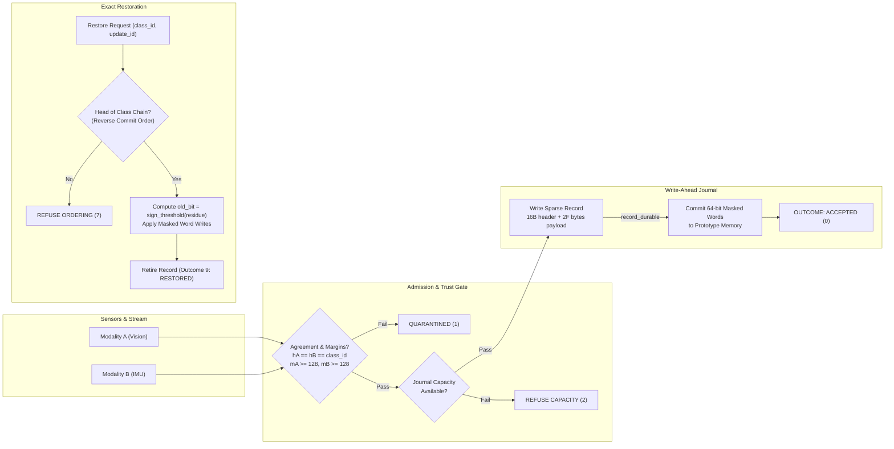

# REVOKE-HDC: Reversible Updates for Compact Binary HDC Prototypes

[](https://www.xilinx.com/products/som/kria/kv260-vision-ai-starter-kit.html)
[](file:///Users/satvik/Downloads/HSC_Lab-P3-main/P3_REVOKE_HDC)
[](file:///Users/satvik/Downloads/HSC_Lab-P3-main/P3_REVOKE_HDC/EVALUATION.md)
[-brightgreen.svg)](file:///Users/satvik/Downloads/HSC_Lab-P3-main/P3_REVOKE_HDC/results/processed/mismatch_summary.md)
[](file:///Users/satvik/Downloads/HSC_Lab-P3-main/P3_REVOKE_HDC/docs/sizing_sheet.md)

> **Team P3 — Live-State FPGA Studio**  
> *Reversible online updates for word-packed hyperdimensional computing (HDC) binary prototypes using write-ahead sparse residue journaling on Xilinx Zynq UltraScale+ FPGA.*

---

## Quick Navigation
- 📘 **[Zero-to-Hero Beginner Textbook (BRIEFING.md)](BRIEFING.md)** *(Start here if you are new to HDC and FPGAs!)*
- 📖 [Complete Engineering Walkthrough](P3_REVOKE_HDC/docs/PROJECT_WALKTHROUGH.md)
- 🚀 [One-Command Reproduction](#quickstart--reproduction)
- 📐 [Architectural Design & Sizing](#sparse-journaling--break-even-math)
- 📊 [Experimental Results & Figures](#experimental-results--figures)
- 📋 [Evaluation Workbook](P3_REVOKE_HDC/EVALUATION.md) | [Friday Metrics Summary](friday_metrics.csv)

---

## The Problem: Information Loss in Thresholded HDC

Hyperdimensional Computing (HDC) classifies streaming sensor queries against high-dimensional prototypes ($D = 4096$ bits) with single-cycle XOR and popcount trees. In hardware, trained class prototypes are quantized down to single-bit binary vectors:
$$b_d = \text{sign\_threshold}(c_d) = \begin{cases} 1 & \text{if } c_d \ge 0 \\ 0 & \text{if } c_d < 0 \end{cases}$$

**The Reversibility Dilemma:**  
Thresholding is non-injective ($\mathbb{Z} \to \{0, 1\}$). A count $c = +1$ and a count $c = +100$ both produce stored bit `1`. If an online update $u = -4$ is applied:
- Count $c = +1 + (-4) = -3 \implies$ **Bit flips to 0**.
- Count $c = +100 + (-4) = +96 \implies$ **Bit remains 1**.

If the update later proves faulty (sensor glitch, adversarial sample, drift), **simple XOR or subtraction cannot restore the prototype**:
- Naive XOR toggles both bits, corrupting dimensions that never flipped.
- Naive subtraction fails because the hidden accumulator magnitude was discarded during binarization.

---

## The Solution: REVOKE-HDC

REVOKE-HDC introduces a **fixed-capacity write-ahead sparse residue journal** paired with a reverse-commit restoration engine:

1. **Multi-Modal Trust Gate**: Updates from vision ($h_A, m_A$) and IMU ($h_B, m_B$) are admitted only if modalities agree ($h_A = h_B = \text{class\_id}$) with margins $\ge 128$.
2. **Bounded Residue Capture**: For dimensions that cross threshold ($F \le 96$), REVOKE-HDC captures a signed 4-bit residue ($[-8, +7]$) representing the pre-threshold distance.
3. **Write-Ahead Logging (WAL)**: A compact sparse record ($16 + 2F$ bytes) is persisted to an on-chip BRAM ring buffer **before** prototype memory write-enables are asserted.
4. **64-Bit Word Combining**: Flips within the same 64-bit word are combined into a single-cycle masked read-modify-write operation.
5. **Exact LIFO Restoration**: Unwinds updates in reverse commit order, recomputing the exact prior bit as $\text{sign\_threshold}(residue)$ directly from the journal record.



---

## Sparse Journaling & Break-Even Math

- **Wire Packet**: $L_{\text{wire}}(F) = 16 + 3F$ bytes (maximum 304 bytes at $F = 96$).
- **Persisted Journal Record**: $R(F) = 16 + 2F$ bytes (maximum 208 bytes at $F = 96$).
- **Snapshot Baseline (Arm C)**: $S = 512$ bytes per class.

### Break-Even Condition
$$16 + 2F < 512 \iff 2F < 496 \iff \mathbf{F < 248}$$

Because the frozen cohort maximum is $F_{\max} = 96$, **REVOKE-HDC operates 100% within the regime where sparse records beat full snapshots**:
- At $F = 40$: **96 bytes** vs 512 bytes (**81.3% memory savings**).
- At $F = 96$: **208 bytes** vs 512 bytes (**59.4% memory savings**).
- Break-Even frequency on 1,000 real updates: **100.0%**.

---

## Four Comparison Arms

| Arm | Stored State | Cost per Update | Behavior on Bad Update & Restoration | Role |
|:---:|---|:---:|---|---|
| **A** | Full Signed Accumulators | $8192\text{ B/class}$ | Direct integer addition/subtraction. Bit-exact by construction. | Mathematical upper bound reference. |
| **B** | Packed Binary Only | $0\text{ bytes}$ | In-place XOR. **Cannot reverse updates**. Damage is permanent. | Unprotected baseline (the harm being solved). |
| **C** | Full Prototype Snapshots | Fixed $512\text{ B}$ | Overwrites prototype with saved 512B image. | Brute-force snapshot baseline. |
| **D** *(Proposed)* | Packed RAM + Sparse Journal | $16 + 2F\text{ B}$ ($97.2\text{ B}$ mean) | WAL BRAM ring + reverse-commit restoration from 4-bit residues. | Proposed compact exact core. |

---

## Experimental Results & Figures

### 1. Zero Mismatch Exact Restoration Regression (1,000 Updates)
- **Total Admitted Updates**: 1,000
- **Total Restorations**: 1,000
- **Total Bit Mismatches**: **0 (Target: 0)** across all 4,096,000 evaluated bit positions!
- **Golden Match**: **`y`** (Bit-identical word-for-word recovery).
- **Flip Count Distribution ($F$)**: Mean = **40.62**, Median = **40**, p95 = **65**, Max = **91** (strictly $\le 96$).
- **Mean Record Size**: **97.23 bytes** (vs 512B snapshot: **81.0% savings**).

### 2. Negative Test Suite (All 10 Injected Cases Passed)
- Tested: Checksum corruption (3), duplicate dimensions (6), alphabet bounds exceeded (4), stale old-bit (5), trust-gate quarantine (1), out-of-order sequence (7), journal full (2), out-of-order restoration (7), corrupted bit prior to restore (8), repeated restoration of retired slot (10).
- **Invariant 7 Verified**: Refused and quarantined requests caused **zero prototype bit changes** and **zero journal byte leaks**.

### Generated Publication Figures
- **Figure 2: Measured Flip-Count Distribution ($F$)**: [`P3_REVOKE_HDC/results/figures/fig2_flip_distribution.svg`](P3_REVOKE_HDC/results/figures/fig2_flip_distribution.svg)
- **Figure 3: Bytes per Update vs Flip Count ($F$) Break-Even Boundary**: [`P3_REVOKE_HDC/results/figures/fig3_bytes_vs_f_breakeven.svg`](P3_REVOKE_HDC/results/figures/fig3_bytes_vs_f_breakeven.svg)

---

## Repository Structure

```text
├── README.md                              # This document
├── CONTRIBUTING.md                        # Branching, PR, and review guidelines
├── METRICS_GUIDE.md                       # Metric column definitions and rules
├── friday_metrics.csv                     # Verified 44-column weekly run ledger
└── P3_REVOKE_HDC/
    ├── README.md                          # Living project run instructions
    ├── PROJECT_PLAN.md                    # Frozen cohort engineering specifications
    ├── EVALUATION.md                      # Eight-week evaluation workbook (Weeks 0-2 GREEN)
    ├── docs/
    │   ├── PROJECT_WALKTHROUGH.md         # Comprehensive end-to-end walkthrough
    │   ├── week0_reading_and_foundations.md # HDC survey, OnlineHD, QuantHD notes
    │   ├── interface_contract.md          # Wire & journal record byte layouts
    │   ├── validation_rules.md            # Packet admission & restoration equations
    │   ├── refusal_table.md               # Outcomes 0..10 with trigger conditions
    │   ├── decision_log.md                # All 16 Week 1 open items closed
    │   ├── sizing_sheet.md                # 16 + 2F vs 512B break-even math
    │   └── ordering_state.md              # Controller FSM & record lifecycle
    ├── configs/
    │   ├── revoke_hdc_config.json         # Machine-readable parameters
    │   └── revoke_hdc_config.yaml         # YAML parameter mirror
    ├── constraints/
    │   └── revoke_hdc_timing.xdc          # 100 MHz PL clock constraints for KV260
    ├── sim/
    │   ├── crc16.py                       # CRC-16/CCITT-FALSE implementation
    │   ├── hdc_core.py                    # 4096-bit prototype RAM & multi-modal encoder
    │   ├── packet.py                      # Wire packet framing & deserializer
    │   ├── journal.py                     # BRAM ring & 1024-slot Record Index Table
    │   ├── engine.py                      # Controller FSM, WAL commit & LIFO restore
    │   └── packet_generator.py            # Valid and negative packet generator
    ├── tests/
    │   ├── hand_vectors.csv               # 42 hand-calculated vectors (36 valid, 6 refused)
    │   ├── hand_vectors.md                # Vector documentation
    │   ├── test_smallest_w2.py            # Hand-built 2-entry smallest test
    │   ├── test_negative_cases.py         # Full 10-case negative test suite
    │   └── test_exact_restoration.py      # 1,000-update regression test
    ├── scripts/
    │   ├── run_all.sh                     # Master one-command reproduction pipeline
    │   ├── run_week0.sh                   # Week 0 foundations check
    │   ├── run_week1.sh                   # Week 1 contract & vector check
    │   ├── run_week2.sh                   # Week 2 regression & negative suite
    │   └── generate_figures.py            # Publication SVG figure generator
    ├── manifests/
    │   ├── P3_20261001_W1_freeze.yaml     # Week 1 contract freeze manifest
    │   └── P3_20261001_W2_software_core.yaml # Week 2 software core manifest
    └── results/
        ├── raw/                           # Raw measurement traces
        ├── processed/                     # Summary reports and JSON statistics
        └── figures/                       # Generated SVG plots
```

---

## Quickstart & Reproduction

No external third-party libraries required (built with Python standard library):

```bash
# Clone the repository
git clone https://github.com/satvikviriyala/REVOKE-HDC-Reversible-Updates.git
cd REVOKE-HDC-Reversible-Updates

# Execute entire verified pipeline (Weeks 0, 1, 2) in one command:
bash P3_REVOKE_HDC/scripts/run_all.sh
```

### Stage-by-Stage Verification

```bash
# Stage 1: Week 0 Foundations & 8-D Hamming Check
bash P3_REVOKE_HDC/scripts/run_week0.sh

# Stage 2: Week 1 Contract, Sizing & 42 Hand Vectors
bash P3_REVOKE_HDC/scripts/run_week1.sh

# Stage 3: Week 2 Smallest Test (2-entry packet)
python3 P3_REVOKE_HDC/tests/test_smallest_w2.py

# Stage 4: Week 2 Negative Test Suite (All 10 Injected Cases)
python3 P3_REVOKE_HDC/tests/test_negative_cases.py

# Stage 5: Week 2 1,000-Update Exact Restoration Regression
python3 P3_REVOKE_HDC/tests/test_exact_restoration.py

# Stage 6: Regenerate Publication Figures
python3 P3_REVOKE_HDC/scripts/generate_figures.py
```

---

## Eight-Week Milestone Roadmap

| Week | Deliverable / Milestone | Status | Key Metric Result |
|:---:|---|:---:|---|
| **W0** | HDC Foundations, Information-Loss Proof, 8-D Hamming Hand Calculation | **GREEN** | Threshold non-injectivity proved; 4 arms frozen |
| **W1** | Contract Freeze, Wire/Journal Formats, Refusal Table, 16 Closed Decisions | **GREEN** | Maximum supported record: **208 bytes** |
| **W2** | Bit-True Software Reference Core, Negative Suite, 1,000-Update Regression | **GREEN** | Restoration mismatches: **0 (Target 0)** |
| **W3** | Packed Prototype & BRAM Journal Memories in SystemVerilog RTL | *Upcoming* | Match software reference for 10,000 cases |
| **W4** | Admission Gate & Reverse-Order Restoration Engine Integration | *Upcoming* | Zero unrecorded bit changes |
| **W5** | Board Bring-Up on Xilinx Kria KV260 with Injected Bad Updates | *Upcoming* | Target 0 Hamming error on hardware |
| **W6** | Four-Arm Memory & Classification Recovery Benchmark Campaign | *Upcoming* | Map empirical $F$ break-even curve |
| **W7** | Endurance, Ordering, Ring-Wrap & Reset Stress Suite | *Upcoming* | Zero bit corruption under full ring wrap |
| **W8** | Final Freeze, Independent Student Reproduction & Handover | *Upcoming* | One-command clean reproduction |

---

## License & Citation
Developed for the Live-State FPGA Studio (Team P3). Subject to course and academic guidelines.
